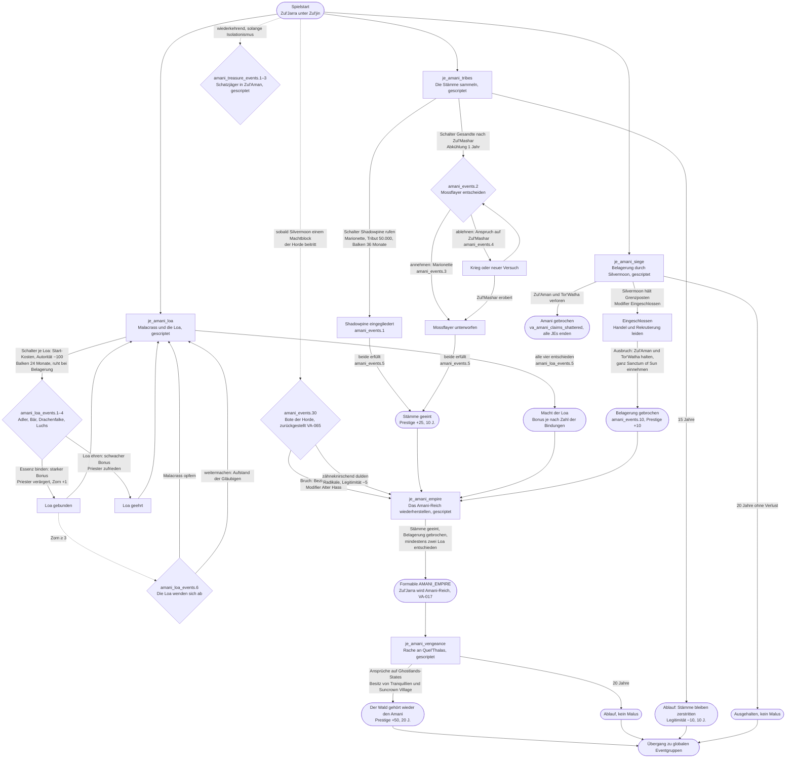

# Ablauf: Zul'Jarra / Amani (Zul'jin) – VA-022, VA-017

Erstentwurf 2026-11-10 nach [konzepte/quel_thalas.md](../konzepte/quel_thalas.md) und den Notizen in VA-022. **Von Kono als V1 abgenommen (2026-11-10) und gescriptet**, außer dem Horde-Boten (zurückgestellt, VA-065). Abweichungen der V1: Belagerung gilt pauschal, solange `je_amani_siege` läuft; Formable `AMANI_EMPIRE` gescriptet 2026-11-12 (VA-017, 6 States, 66 %); Schatzjäger heißen `amani_treasure_events.1–3`. **Fest** sind nur: Träger `AMANI_TRIBE` (heißt „Zul'Jarra“ bis zum Formable `AMANI_EMPIRE`), zum Reich gehören `SHADOWPINE_TRIBE` und `MOSSFLAYER_TROLLS`, Silvermoon will die Trolle nach Zul'Aman zurücktreiben und einsperren. Alles andere (Loa-Reihe, Schatzjäger, Horde, Dauern, Kosten, Prestige) ist ein Vorschlag von Claude aus der Zul'Aman-Lore und wartet auf Konos Quest-Lektüre. Ziel: 25–40 Jahre Inhalt, danach globale Eventgruppen (VA-034).

Ausgangslage im Mod: Zul'Jarra besitzt `STATE_ZUL_AMAN` (Hauptstadt) und `STATE_TOR_WATHA` (auch Heimat der `sin_dorei`), Shadowpine ist Marionette (`STATE_SUNCROWN_VILLAGE`, `STATE_DAWNSTAR_SPIRE`, `STATE_SANCTUM_OF_SUN`), Mossflayer ist eigenständig (`STATE_ZUL_MASHER`). Gesetze: Theokratie, Isolationismus, Sklavenhandel. Kulturen `forest_troll`, `dire_troll`, Religion `amani_loa`. Noch kein Herrscher Zul'jin angelegt (VA-016).

| Knoten | Bedingung (Auslöser) | Folge | Dauer im Spiel | Aufwand Spieler |
|---|---|---|---|---|
| `je_amani_tribes` | Spielstart (`AMANI_TRIBE`); ungültig bei `va_amani_claims_shattered` | Zwei Teilziele. **Shadowpine:** Schalter startet Eingliederung der Marionette (Tribut 50.000, Autorität −50, Balken 36 Monate, ruht im Krieg; Kono-Test 2026-11-12) → `amani_events.1`, `annex_with_incorporation`. **Mossflayer:** Schalter schickt Gesandte → `amani_events.2` bei Mossflayer (KI nimmt eher an, je stärker Zul'Jarra und je mehr Loa entschieden) → Marionette (`.3`) oder Ablehnung mit Anspruch auf `STATE_ZUL_MASHER` (`.4`). Beide erfüllt → `amani_events.5`, Prestige +25 für 10 J. Vorbild: `je_silvermoon_wretched` (Pakt-Schalter, Abkühlung), Vanilla `05_serbia.txt` | `timeout` 15 Jahre, gedacht 5–10 | mittel: zwei Schalter, ggf. ein Krieg |
| `je_amani_loa` | Spielstart; Hexlord Malacrass als Anführer der Priester-IG | Je Loa (Akil'zon/Adler, Nalorakk/Bär, Jan'alai/Drachenfalke, Halazzi/Luchs) ein Schalter, immer nur einer aktiv: Start-Kosten, Autorität −25 laufend, Balken 24 Monate. Am Ende Event mit Wahl: **binden** (starker Länder-Modifier, z. B. Adler Aufklärung/Offensive, Bär Verteidigung, Drachenfalke Moral, Luchs Rekrutierung; Priester-IG −, Zähler `va_amani_loa_wrath` +1) oder **ehren** (halber Bonus, Priester-IG +). Zorn ≥ 3 → `amani_loa_events.6`: Malacrass opfern (Zorn zurück, ein gebundener Bonus fällt weg) oder Aufstand der Gläubigen. Alle vier entschieden → `amani_loa_events.5`. Vorbild: `je_silvermoon_corridor` (Etappen-Schalter und Balken) | 4 × 2 Jahre, mit Pausen 8–12; kein `timeout` | mittel: laufende Kosten, vier Entscheidungen |
| `je_amani_siege` | Spielstart, solange `c:SILVERMOON` existiert. Gegenstück zu `je_silvermoon_zul_aman` in der neuen Form „zurücktreiben und einsperren“ | Solange Silvermoon seine Eindämmung hält (Variable von Silvermoons JE, Form noch offen): Länder-Modifier „Eingeschlossen“ (Handel, Rekrutierung). Gebrochen, wenn Zul'Jarra Zul'Aman und Tor'Watha hält und ganz `STATE_SANCTUM_OF_SUN` besitzt (Anteile Shadowpine, Tranquillien, Nachtelfen; Kono 2026-11-10) → `amani_events.10`, Prestige +10. Verlust von Zul'Aman **und** Tor'Watha → `va_amani_claims_shattered`, alle Amani-JEs enden | `timeout` 20 Jahre, gedacht 5–15 | hoch: Krieg gegen Silvermoon bzw. standhalten |
| Schatzjäger (`amani_events.20–22`) | Zufall etwa alle 3–5 Jahre, solange `law_isolationism` gilt | Fremde plündern Gräber: hinrichten (Autorität +, Beziehungen −), Lösegeld (Geld +), als Händler dulden (kleiner Schritt weg vom Isolationismus, Priester −) | über die ganze Laufzeit | gering je Event |
| Bote der Horde (`amani_events.30`) | einmalig, sobald Silvermoon mit einem Horde-Land im selben Machtblock ist (Trigger hängt an VA-034/Machtblöcken) | Bruch (Beziehungen −50 zu den Horde-Ländern, Modifier „Alter Hass“: Kampfmoral gegen Elfen) oder dulden (Radikale, Legitimität −5, Handel möglich) | einmalig | gering |
| `je_amani_empire` | Stämme geeint | Erfüllt bei: Stämme geeint, Belagerung gebrochen oder ausgehalten, mindestens zwei Loa entschieden, kein `va_amani_claims_shattered` → schaltet Formable `AMANI_EMPIRE` frei (VA-017), Name wechselt von Zul'Jarra zu Amani-Reich. Vorbild: `00_italian_unification.txt` | kein `timeout`, gedacht bis Jahr 15–20 | ergibt sich aus den drei Ziel-JEs |
| `je_amani_vengeance` | nach Gründung des Amani-Reichs | Ansprüche auf die Ghostlands-States. Erfüllt bei Besitz von `STATE_TRANQUILLIEN` und `STATE_SUNCROWN_VILLAGE` → Prestige +50 für 20 J. | `timeout` 20 Jahre, gedacht 10–15 | hoch: Krieg gegen Silvermoon/Deathholme |
| Gesamt | | | **ca. 25–40 Jahre** | |

## Offen

- **Konos Quest-Lektüre:** Welche Zul'jin-/Zul'Aman-Quests sollen zusätzlich als Events rein? Loa-Reihe und Schatzjäger sind als V1 abgenommen.
- **Horde-Bote:** wartet auf VA-065 (warum Silvermoon die Horde verlässt).
- **Charaktere:** Zul'jin, Malacrass und die Silvermoon-Seite fehlen als Charaktere (VA-016, VA-066).
- **Silvermoons Eindämmung:** `je_silvermoon_zul_aman` ist noch die alte Form (Zul'Aman + Tor'Watha besitzen). Wie misst Silvermoon „zurückgetrieben und eingesperrt“ (Tor'Watha und die Shadowpine-States in Silvermoons Hand, Zul'Aman bleibt)? Davon hängt `je_amani_siege` ab; beide Seiten zusammen umbauen.
- **Zul'jin als Charakter:** Herrscher mit Eigenschaften (einäugig, einarmig) fehlt noch (VA-016). Soll sein Tod die Reihe verändern (z. B. Malacrass übernimmt)?
- **Loa binden:** Lore-nah endet das schlecht für die Loa. Soll „alle vier binden“ einen eigenen, dunkleren Ausgang haben (z. B. Zul'jin nimmt selbst eine Essenz auf)?
- **Rache-JE:** Ziel nur Ghostlands oder ganz Quel'Thalas bis Silvermoon? Und was passiert mit den `sin_dorei`-Pops (Sklavenhandel-Gesetz ist schon aktiv)?
- **Spielt die KI Zul'Jarra:** Schalter brauchen `ai_chance`, sonst passiert ohne Spieler nichts (wie beim Korridor).
- Alle Werte (Kosten, Monate, Prestige, Modifier) sind Vorschläge.
