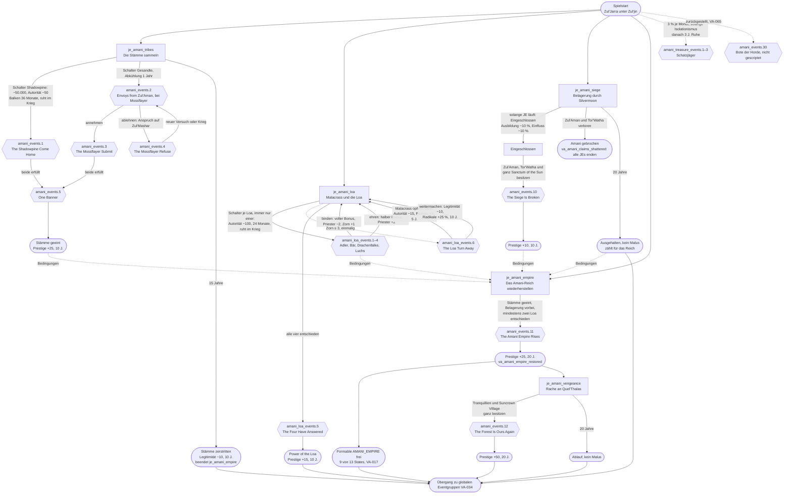

# Ablauf: Zul'Jarra / Amani (Zul'jin) – VA-022, VA-017

Erstentwurf 2026-11-10 nach [konzepte/quel_thalas.md](../konzepte/quel_thalas.md), von Kono als V1 abgenommen und gescriptet. **Stand: Release 2026-11-14 (Commit „Zul Jara und Silvermoon release“), mit dem Script abgeglichen.** Zurückgestellt: Horde-Bote (VA-065). **Fest** sind: Träger `AMANI_TRIBE` (heißt „Zul'Jarra“ bis zum Formable `AMANI_EMPIRE`), zum Reich gehören `SHADOWPINE_TRIBE` und `MOSSFLAYER_TROLLS`, Silvermoon will die Trolle nach Zul'Aman zurücktreiben und einsperren. Werte sind Vorschläge von Claude, soweit nicht als Kono-Test markiert. Ziel: 25–40 Jahre Inhalt, danach globale Eventgruppen (VA-034). Gegenseite: [silvermoon.md](silvermoon.md).

Ausgangslage im Mod: Zul'Jarra besitzt `STATE_ZUL_AMAN` (Hauptstadt) und `STATE_TOR_WATHA` (auch Heimat der `sin_dorei`), Shadowpine ist Marionette (`STATE_SUNCROWN_VILLAGE`, `STATE_DAWNSTAR_SPIRE`, `STATE_SANCTUM_OF_SUN`), Mossflayer ist eigenständig (`STATE_ZUL_MASHER`). Gesetze: Theokratie, Isolationismus, Sklavenhandel. Kulturen `forest_troll`, `dire_troll`, Religion `amani_loa`. Charaktere Zul'jin (`va_qt_zuljin`) und Malacrass (`va_qt_malacrass`) angelegt (VA-066, wartet auf Spieltest).

Alle JEs starten zum Spielstart aus `va_global_quel_thalas.txt` (außer `je_amani_vengeance`) und enden still, sobald die globale Variable `va_amani_claims_shattered` gesetzt ist (Silvermoon erfüllt `je_silvermoon_zul_aman` oder Zul'Jarra verliert das Kernland).

## Ablauf

Sechseck = Event, Rechteck = JE oder Zustand, abgerundet = Ende.

## Journal Entries

| JE | Start | Erfüllt | Fehlschlag / Ablauf | Dauer | Aufwand |
|---|---|---|---|---|---|
| `je_amani_tribes` | Spielstart | **Shadowpine:** Schalter, −50.000 Tribut, Autorität −50 laufend, Balken 36 Monate, ruht im Krieg (Kono-Test 2026-11-12) → `amani_events.1`, `annex_with_incorporation`. **Mossflayer:** Schalter (KI 50 %, 1 Jahr Abkühlung) → `amani_events.2` bei Mossflayer → Marionette (`.3`) oder Anspruch auf `STATE_ZUL_MASHER` (`.4`). Beide → `amani_events.5`, `va_amani_tribes_united` (Prestige +25, 10 J.) | 15 J. → `va_amani_tribes_divided` (Legitimität −10, 10 J.), setzt `va_amani_tribes_failed` → `je_amani_empire` endet | gedacht 5–10 J. | mittel |
| `je_amani_loa` | Spielstart | Je Loa ein Schalter (KI 25 % ohne Schulden), immer nur ein Ritual: `va_amani_loa_ritual` (Autorität −100), Balken 24 Monate, ruht im Krieg → `amani_loa_events.1–4` mit Wahl **binden** oder **ehren**. Alle vier → `amani_loa_events.5`, `va_amani_power_of_the_loa` (Prestige +15, 10 J.) | kein `timeout` | 4 × 2 J., mit Pausen 8–12 | mittel |
| `je_amani_siege` | Spielstart; Anspruch auf `STATE_SANCTUM_OF_SUN` | Zul'Aman, Tor'Watha und ganz Sanctum of the Sun besitzen (Kono 2026-11-10) → `amani_events.10`, `va_amani_siege_broken` (Prestige +10, 10 J.) | Zul'Aman **und** Tor'Watha verloren → setzt `va_amani_claims_shattered`; 20 J. → ausgehalten, kein Malus | gedacht 5–15 J. | hoch |
| `je_amani_empire` | Spielstart | Stämme geeint, Belagerung vorbei (gebrochen oder ausgehalten), mindestens zwei Loa entschieden → `amani_events.11`, `va_amani_empire_restored` (Prestige +25, 20 J.), schaltet Formable frei, startet `je_amani_vengeance` | still bei Kernlandverlust oder zerstrittenen Stämmen | ergibt sich, gedacht bis Jahr 15–20 | aus den drei Zielen |
| `je_amani_vengeance` | nach `je_amani_empire`; Ansprüche auf Tranquillien, Suncrown Village, East Sanctum, Windrunner Village | Tranquillien und Suncrown Village ganz besitzen → `amani_events.12`, `va_amani_forest_reclaimed` (Prestige +50, 20 J.) | 20 J., kein Malus | gedacht 10–15 J. | hoch |
| Formable `AMANI_EMPIRE` (VA-017) | `va_amani_empire_restored` | 9 von 13 States (Zul'Aman, Tor'Watha, Dawnstar Spire, Sanctum of the Sun, Suncrown Village, Zul'Mashar, Northpass Tower, East Sanctum, Sunsail Anchorage, Duskwither Spire, Windrunner Village, Tranquillien, Deathholme; Kono 2026-11-13) | – | – | hoch |

### Loa-Boni

| Loa | Event | Binden (voll) | Ehren (halb) |
|---|---|---|---|
| Akil'zon, Adler | `amani_loa_events.1` | Angriff +10 % | +5 % |
| Nalorakk, Bär | `amani_loa_events.2` | Verteidigung +10 % | +5 % |
| Jan'alai, Drachenfalke | `amani_loa_events.3` | Moralverlust −10 % | −5 % |
| Halazzi, Luchs | `amani_loa_events.4` | Ausbildung +20 % | +10 % |

Binden: Priester (`ig_devout`) Zustimmung −2, Zorn +1. Ehren: Priester +2.

## Alle Events auf einen Blick

| Event | Titel | Auslöser | Optionen / Folge |
|---|---|---|---|
| `amani_events.1` | The Shadowpine Come Home | Shadowpine-Balken 36/36 | Shadowpine eingegliedert |
| `amani_events.2` | Envoys from Zul'Aman | Schalter Gesandte, Event bei Mossflayer | a) „We follow Zul'jin.“ → `.3` · b) ablehnen → `.4` |
| `amani_events.3` | The Mossflayer Submit | Antwort an Zul'Jarra | Mossflayer werden Marionette |
| `amani_events.4` | The Mossflayer Refuse | Antwort an Zul'Jarra | Anspruch auf Zul'Mashar |
| `amani_events.5` | One Banner | `je_amani_tribes` erfüllt | Stämme geeint |
| `amani_events.10` | The Siege Is Broken | `je_amani_siege` erfüllt | Belagerung gebrochen |
| `amani_events.11` | The Amani Empire Rises | `je_amani_empire` erfüllt | Formable frei, Rache-JE startet |
| `amani_events.12` | The Forest Is Ours Again | `je_amani_vengeance` erfüllt | Wald zurückerobert |
| `amani_loa_events.1–4` | The Shrine of the Eagle / Bear / Dragonhawk / Lynx | Loa-Ritual fertig (24 Monate) | a) binden · b) ehren |
| `amani_loa_events.5` | The Four Have Answered | `je_amani_loa` erfüllt | Power of the Loa |
| `amani_loa_events.6` | The Loa Turn Away | Zorn ≥ 3, einmalig | a) Malacrass opfern (stirbt, Autorität −15 für 5 J., Priester versöhnt) · b) weitermachen (Legitimität −10, Radikale +25 % für 10 J.) |
| `amani_treasure_events.1` | Grave Robbers in the Outer Court | Schatzjäger (3 % je Monat, Isolationismus, 3 J. Abkühlung) | a) Köpfe an die Mauer · b) Lösegeld |
| `amani_treasure_events.2` | An Expedition at the Gate | wie oben | a) vertreiben · b) Gold nehmen, Tempel sperren |
| `amani_treasure_events.3` | A Relic Is Missing | wie oben | a) Jäger hinterherschicken · b) Idol aufgeben |
| `amani_events.30` | (Bote der Horde) | nicht gescriptet, VA-065 | Bruch oder dulden |

Silvermoons Gegen-Event zu Zul'Aman: `silvermoon_events.3` (siehe [silvermoon.md](silvermoon.md)).

## Offen

- **Konos Quest-Lektüre:** Welche Zul'jin-/Zul'Aman-Quests sollen zusätzlich als Events rein?
- **Horde-Bote:** wartet auf VA-065 (warum Silvermoon die Horde verlässt).
- **Silvermoons Eindämmung:** `je_amani_siege` gilt pauschal, solange es läuft; `je_silvermoon_zul_aman` ist noch die alte Form (Zul'Aman + Tor'Watha besitzen). Beide zusammen auf „zurücktreiben und einsperren“ umbauen.
- **Zul'jins Tod:** Soll er die Reihe verändern (z. B. Malacrass übernimmt)?
- **Alle vier binden:** eigener, dunklerer Ausgang (z. B. Zul'jin nimmt selbst eine Essenz auf)?
- **Rache-JE:** Ziel nur Ghostlands oder ganz Quel'Thalas? Was passiert mit den `sin_dorei`-Pops (Sklavenhandel ist aktiv)?
- **Abschluss-Events** für Ablauf und Fehlschlag fehlen (Stämme zerstritten, Belagerung ausgehalten, Amani gebrochen laufen ohne Popup).
- Alle Werte (Kosten, Monate, Prestige, Modifier) sind Vorschläge.
