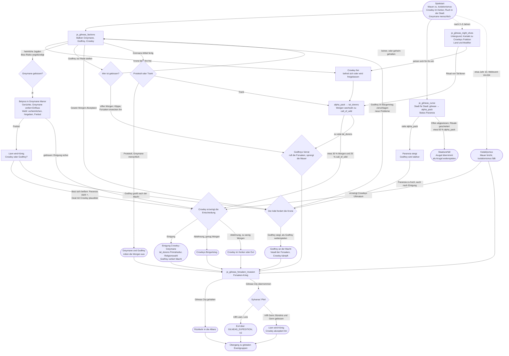

# Ablauf: Gilneas (Genn Greymane) – VA-007

Entwurf 2026-11-13, Version 4 (2026-11-14): mit Kono durchgesprochen und auf Logikfehler geprüft. Lore-Recherche (Wiki, YouTube-Video) steht in [`lore/gilneas.md`](lore/gilneas.md). „Kono“ = Vorgabe von Kono, „Vorschlag“ = Idee von Claude. Werte und Schwellen werden erst beim Scripten festgelegt. Ziel: 25–40 Jahre Inhalt, danach globale Eventgruppen (VA-034). Feinheiten (Greymanes Biss, Liam als König) folgen, sobald das Gerüst steht.

## Kurzfassung

Gilneas liegt kurz vor dem Kataklysmus abgeschottet hinter dem Greymane-Wall. Arugals Worgen-Fluch ist schon in der Stadt und breitet sich Stadt für Stadt aus. Drei Fraktionen ringen darum, wie man damit umgeht: Greymane (Krone) leugnet und bekämpft heimlich, Godfrey (Adel) will ausrotten, Crowley (Northgate) will verschonen. Die Nachtelfen kommen nach 2–3 Jahren und machen aus wilden Worgen intelligente. Nach etwa 10 Jahren bricht der Kataklysmus die Mauer, oder Godfrey sprengt sie früher, und die Forsaken greifen an.

## Ausgangslage im Mod

`GILNEAS` (Kultur `gilnean`, `holy_light`) besitzt sieben States: `STATE_GILNEAS_CITY` (Hauptstadt), `STATE_NORTHGATE_WOODS`, `STATE_NORTHERN_HEADLANDS`, `STATE_THE_HEADLANDS`, `STATE_EMBERSTONE`, `STATE_KOROTH_DEN`, `STATE_STORMGLEN_VILLAGE`. Das Protektorat `GILNEAS_EXPEDITION` liegt in `STATE_TAINTED_FOREST` (Duskwood). Nachbarn sind `SHADOWFANG_KEEP` (`alpha_pack`, Arugal, Protektor von `BLOODFANG_PACK`) und `UNDERCITY`. `alpha_pack` lebt schon in Duskwood (`STATE_DARKSHIRE`, `STATE_TRANQUIL_GARDENS_CEMESTERY`). Nötige Änderungen:
- **Startgesetze nach dem Vorbild Japan** (Kono, 2026-11-14; Vanilla `jap - japan.txt`: `law_sakoku`, `law_closed_borders`):
  - Handelspolitik: **eigenes Gesetz `va_law_greymane_wall`** mit `parent = law_isolationism`, wie Vanilla `law_sakoku`, und bis zum Mauerfall gesperrt (Kono, 2026-11-14, entschieden). Protektionismus entfällt, weil er in derselben Gruppe `lawgroup_trade_policy` liegt.
  - Migration: `law_closed_borders`.
  - Wirtschaftssystem (das Industrie-Gesetz) beim Anlegen der History festlegen; die übrigen Japan-Gesetze dort einzeln prüfen.
- Der alte Platzhalter `je_infected_gilnean` wird durch `je_gilneas_curse` ersetzt.

## Startzustand (Kono)

- **Gilneas ist komplett isoliert.** Die Mauer lässt sich nicht öffnen. Modifier „Hinter dem Greymane-Wall“: Abwehr +, kein Handel.
  - Kono, 2026-11-14: Die Mauer ist ein passiver Zustand wie das Mana in Quel'Thalas. Der Spieler kann sie bis zum Mauerfall nicht ändern; das Isolationismus-Gesetz ist so lange gesperrt. Mali wie bei Japans Abschottung, Vorbild Vanilla `je_sakoku` / `law_sakoku` (`07_sakoku.txt`). Die Mauer hält das Land gegen die Untoten ringsum sicher.
  - **Verteidigungsbündnis mit Sturmwind** (Kono): Trotz Mauer lässt sich daran arbeiten, es soll aber sehr schwer sein. Gelingt es, steht Sturmwind beim Forsaken-Angriff an Gilneas' Seite. Es stärkt eher Godfreys Seite als Greymanes.
- **Crowley sitzt im Kerker** (Stoneward Prison). Die Mauer hat Crowleys Land vor der Mauer abgeschnitten. Daraufhin hat die Northgate-Rebellion einen halben Bürgerkrieg angefangen, der in Gilneas City niedergeschlagen wurde. Seine Anhänger leben weiter in den ländlichen States hinter der Mauer (`ig_rural_folk`) und haben einen Groll auf die Krone. Im Vic3-Maßstab ist es egal, ob die Kämpfe in der Stadt oder davor stattfanden. Entscheidend sind der abgeschnittene Landesteil und die gescheiterte Rebellion (angepasst 2026-11-14 nach Video-Lore).
- **Der Fluch ist schon in Gilneas City.**
- **Greymane ist noch nicht gebissen.**

## Figuren und Fraktionen (Kono)

Drei Fraktionen, ausgebaut nach Vanilla `je_divided_monarchists` (Frankreich). Zwei davon sind Interessengruppen, die dritte ist die Krone.

- **Greymane** (Krone und Königsfamilie, steht für das Heilige Licht, keine eigene IG):
  - Will den Fluch aufhalten, ist aber zu schwach dafür.
  - Leugnet den Fluch öffentlich und bekämpft ihn heimlich: Er geht auf Jagd, hält Kultisten auf, tötet Worgen und behindert die Nachtelfen.
  - Die Krone wird meist vom Adel getragen, daher der Grundkonflikt **Greymane gegen Godfrey**.
  - Er kann nur führen, solange er nicht gebissen ist.
- **Godfrey** (Adel, `ig_landowners`):
  - Will die Worgen jagen. Nur über ihn lässt sich der Fluch aufhalten.
  - Akzeptiert die Worgen **nie** und wird lieber ein Verlassener, als sein Land den Worgen zu überlassen.
- **Crowley** (Northgate, `ig_rural_folk`):
  - Agrarisch, will die Bauern stärken. Will die Krone nicht und ist ihr treu, will aber die Worgen verschonen.
  - Sitzt anfangs im Kerker. Die Fraktion handelt ohne ihn, bis er freikommt.
  - Wird über eigene Events gebissen, noch vor dem Krieg (Lore: in der Kathedrale, als er die Evakuierung deckt).
- **Krennan Aranas** (königlicher Chemiker): entwickelt mit Greymane und Godfrey das Heilmittel.
- **Belysra Starbreeze** (Nachtelfe, Priesterin der Mondgöttin): hilft Greymane nach seinem Biss und hat großen Einfluss darauf, wie es weitergeht.
- **Liam Greymane:** Thronfolger, kann unter bestimmten Bedingungen König werden.

## Mechaniken

### Fluch (`je_gilneas_curse`)

- Der Fluch erfasst Stadt für Stadt: Balken je State, 12–18 Monate (Vorschlag), Fortschritt als Variable an der **State-Region**.
- **Nicht alle werden Worgen** (Kono): Je State wird nur ein Teil der `gilnean`-Pops zu `alpha_pack` (wilde, geistlose Worgen). Die Obergrenze je State ist offen.
- Wiederkehrende Events: Bisse, Vermisste, Bestien in den Gassen.
- Vorschlag (aus Video-Lore): Eventkette **„Starlight-Slasher-Morde“**. Erst werden die Northgate-Rebellen verdächtigt (Crowley −, Paranoia +), dann kommt das Gerücht auf, ein Kult nehme den Fluch freiwillig an. Wahl: Rebellen beschuldigen, Kult jagen (Godfrey +) oder vertuschen (Greymane +, Paranoia später stärker).
- Vorschlag: Bei den **Vollmondjagden** zieht der Adel mit Greymane los; daraus ergibt sich der Takt der Jagd-Events (etwa monatlich, mit Abklingzeit).
- Bis etwa Jahr 10 sollen alle sieben States betroffen sein.

### Paranoia (Status im Fluch-JE)

- Länder-Variable 0–100 mit Stufen wie „Gerüchte“, „Angst“, „Hexenjagd“.
- **Grundwert** ist der Worgen-Anteil an der Bevölkerung (Kono). Wilde Worgen (`alpha_pack`) zählen viel stärker als intelligente (`tal_dorens`) (Kono).
- **Steigt durch:** Fluch-Events, jeden neu infizierten State, entdeckte Nachtelfen, Jagden, über die geredet wird.
- **Sinkt durch:** Zensur- und Polizeigesetze, die Event-Wahl „vertuschen“, Fortschritt des Heilmittels, gelungene Rituale.
- **Wirkung:** Hohe Paranoia stärkt Godfrey und macht es der Krone unmöglich, weiter zu leugnen. Niedrige Paranoia stärkt Greymane.

### Fraktionsbalken (`je_gilneas_factions`, Vorschlag)

| Balken | Füllt sich durch | Leert sich durch |
|---|---|---|
| **Greymane** | Legitimität; niedrige Paranoia; Mauer hält; Schalter „Königliches Dekret“; Liam an seiner Seite | Godfrey überflügelt ihn; hohe Paranoia; Greymane gebissen (danach kein Einfluss mehr zurückzugewinnen) |
| **Godfrey** | hohe Paranoia; viele `alpha_pack`; Einfluss und Zustimmung `ig_landowners`; Polizei- und Ordnungsgesetze; Isolationismus bleibt (Vorschlag: Mauer und Abschottung waren sein Rat); Schalter „Jagd ausrufen“ | viele `tal_dorens`; gelungene Rituale; Einigung Crowley–Greymane (verliert viel Macht) |
| **Crowley** | Anteil verfluchter Pops; Einfluss `ig_rural_folk`; bauernfreundliche Agrar- und Pachtgesetze; Nachtelfen; Crowley frei | hohe Paranoia; Jagden; Crowley im Kerker |

Status-Text wie im Vorbild: Wer führt, und sitzt diese Seite an der Macht? Je Fraktion ein Schalter und wiederkehrende Events (Bauernklagen, Adelsforderungen, Hofintrigen).

### Nachtelfen (`je_gilneas_night_elves`)

- Kommen nach **2–3 Jahren**, weil sie sich für den Fluch verantwortlich fühlen (Kono).
- Arbeiten erst im Untergrund und klären auf, während die Krone sie und den Fluch leugnet.
- Ihr erster Ansprechpartner ist **Crowleys Fraktion**, auch wenn Crowley im Kerker sitzt, weil viele seiner Leute gebissen sind und die Fraktion auch vor der Mauer lebt. Sie setzen sich für seine Freilassung ein (Kono).
- Sie **bekommen einen Teil des Landes** und lösen Modifier aus (Kono).
- **Ritual von Tal'doren:** macht aus `alpha_pack` nach und nach `tal_dorens`.

### Religion (Kono)

- Die Worgen fühlen sich vom Licht und von der Krone verlassen und wechseln nach und nach zu `call_of_wild`, je stärker die Nachtelfen, desto mehr.
- Der Wechsel **hört auf, sobald Crowley und Greymane sich einigen**. Danach entscheidet der Spieler die Staatsreligion: `call_of_wild` (Bindung an die Nachtelfen, eigener Weg danach) oder dem Licht treu bleiben.

## Wendepunkte

1. **Crowley kommt frei:** Er befreit sich selbst, mit Hilfe seiner Fraktion und der Nachtelfen (Kono), oder die Krone lässt ihn frei (Lore: Genn lässt ihn beim Worgen-Angriff frei).
2. **Greymanes Biss:** Ob Greymane bei den heimlichen Jagden mitgeht, entscheidet der Spieler. Jede Jagd birgt ein angekündigtes Biss-Risiko. Meidet er sie, bleibt er menschlich, die Worgen wachsen aber freier.
   - Wird er gebissen, verheimlicht er es. Belysra versucht in Greymane Manor immer wieder, den Fluch auszutreiben, ohne Erfolg.
   - Das Volk hält es für eine Liebschaft. Vorschlag: Event „Die Geliebte des Königs“ mit Wahl zwischen vertuschen (Skandal), bloßstellen (Paranoia +, Godfrey +) und die Wahrheit sagen (Biss bekannt).
   - Danach kann Greymane keinen Einfluss mehr zurückgewinnen.
   - **Spielerentscheidung nach dem Biss** (Kono, 2026-11-14): verheimlichen (wie oben), sich bewusst dem Fluch hingeben oder sich das Leben nehmen. Beim Freitod spielt man als **Liam** weiter. Das ist auch vor Crowleys Ultimatum möglich.
   - **Liam als König:** Er entscheidet, ob er sich Crowley oder Godfrey anschließt. Ohne weiteres ist Godfrey der leichtere Weg. **Liams Weg zu Crowley** (Kono, 2026-11-14): Liam lässt sich bewusst beißen und nimmt den Fluch an. Die Paranoia steigt dadurch sehr stark, aber ein Deal mit Crowley wird wesentlich plausibler. Das kann Crowleys Bedingung für eine Zusammenarbeit sein.
   - **Charakter Liam** (Kono): Hoffnungsträger wie Anduin in Sturmwind. Er versucht naiv, das Land zusammenzuhalten, weiß aber nicht, welcher Weg der richtige ist. Später ausarbeiten.
3. **Heilmittel:** Krennans Mittel läuft passiv. Ist es fertig, entscheidet das Event **„Protokoll oder Trank“** über den Weg (Kono, 2026-11-14: Die Lore ist nur Orientierung, beide Wege sollen spielbar sein):
   - **Trank (Lore-Weg):** Das Serum dämpft den Blutdurst. Ein Teil der `alpha_pack` wird zu `tal_dorens`, Greymane +, Godfrey −, Greymane rückt näher an Crowley.
   - **Protokoll (alternativer Weg, nur mit menschlichem Greymane):** Das Mittel wirkt als Schutz gegen neue Ansteckung. Greymane gibt Godfrey nach, und beide rotten die Worgen gemeinsam aus. Ausgerottete Pops sterben und sind weg; die Höchstzahl wird beim Ausbalancieren festgelegt.
   - Vorschlag: Ist Greymane gebissen, gibt es nur den Trank.
4. **Crowleys Schwelle** (Kono: etwa 30 % Worgen und etwa 25 % `call_of_wild` in der Gesamtbevölkerung; die Zahlen werden beim Anlegen der JEs zusammen mit der Worgen-Obergrenze festgelegt). Spätestens **der Mauerfall erzwingt das Ultimatum** (Kono, 2026-11-14), falls die Schwelle bis dahin nicht erreicht ist: Einigung finden oder sich den Forsaken unterwerfen. Crowley erzwingt die Entscheidung:
   - **Einigung mit Greymane:** Ist Greymane gebissen, wird es ein echtes Bündnis und gelingt sicher. Ist er menschlich, wird es eine **Zweckgemeinschaft** (Kono): schwerer, aber möglich, und die Worgen sind noch nicht ganz akzeptiert. Folgen: `tal_dorens` wird zusätzliche Primärkultur, der Religionswechsel endet, die Staatsreligion wird gewählt, und Godfrey verliert viel Macht.
   - **Bürgerkrieg:** Lehnt Greymane ab und gibt es genug Worgen, beginnt Crowley einen Bürgerkrieg.
   - **Kerker oder Exil:** Lehnt Greymane ab und gibt es zu wenige Worgen, kommt Crowley wieder in den Kerker oder wird verbannt, vielleicht zu `GILNEAS_EXPEDITION`.
5. **Godfreys Machtgriff:** Wird die Paranoia zu hoch, vor allem durch viele `alpha_pack`, erklärt der Adel den König für unfähig. Das geschieht mit oder ohne Einigung, mit Einigung eher früher. Event „Der Adel fordert die Krone“: Man spielt als Godfrey weiter, oder man zerschlägt ihn im Bürgerkrieg, was neue Probleme bringt. Folgen noch ausarbeiten.
6. **Godfrey zur Rede stellen** (Kono, 2026-11-14): Der Spieler kann Godfrey vor dem Verrat stellen. Was passiert, hängt vom bisherigen Verlauf ab:
   - Keiner der beiden ist gebissen: Bündnis mit Godfrey.
   - Gebissen, aber erfolgreich verheimlicht: Bündnis, das später Probleme bringt (Aufdeckung).
   - Offen Worgen: Godfrey springt von der Klippe und wird von den Forsaken erweckt. Seine Fraktion ist damit vorerst raus. Die Forsaken haben ihn als Anführer und greifen Gilneas leichter an (Buffs).
   - **Godfreys Loyalität** (Kono): Unter Genn bleibt er loyal, solange Genn die Worgen nicht akzeptiert. Unter Liam versucht er auf jeden Fall, die Macht zu ergreifen.
   - **Gesetz „Worgen-Akzeptanz“** (Kono; analog zum Untoten-System VA-048): Bringt der Spieler es ein, oder werden die Worgen akzeptierte Kultur, erklärt Godfrey die Krone für gefallen, und es kommt zum Bürgerkrieg.
7. **Godfreys Verrat:** Gibt es zu viele `tal_dorens`, setzen sich die Worgen also durch, ruft Godfrey die Forsaken und wird ihr Vasall. Das kann auch vor dem Kataklysmus geschehen; dann sprengt er die Mauer selbst. Eine Landung der Forsaken über das Meer ist denkbar, am Anfang aber sehr schwer.
8. **Kataklysmus** (Weltevent etwa Jahr 10, VA-034; betrifft alle, Quel'Thalas kaum): Die Mauer bricht, falls sie noch steht. Der Verteidigungsbonus und der Isolationismus fallen weg, Crowleys Ultimatum wird erzwungen (Wendepunkt 4), und der Forsaken-Krieg beginnt.

## Ausgänge

- **Ausrottung:** Greymane und Godfrey haben die Worgen ausgerottet. Gilneas bleibt menschlich und beim Licht, geht dann in den Forsaken-Krieg.
- **Godfrey an der Macht:** Greymane ist gebissen oder gestürzt, es gibt keine Einigung. Crowley beginnt seinen Bürgerkrieg. Godfrey wird Vasall der Forsaken und bekommt dafür ganz Gilneas. Er will die Worgen ausrotten und Gilneas zu alter Pracht führen, als Knecht der Forsaken; das ist ein Problem für später.
- **Einigung Crowley–Greymane:** Gemeinsamer Krieg gegen die Forsaken. Bei zu hoher Paranoia beginnt Godfrey trotzdem einen Bürgerkrieg.
- **Das wilde Rudel** (Kono, 2026-11-14; Scheitern als Spielweg): Der Spieler weist die Nachtelfen ab oder die Rituale scheitern, und `alpha_pack` wächst ungebremst. Besteht etwa die Hälfte der Bevölkerung aus `alpha_pack`, bricht der Staat zusammen, und Arugal (`SHADOWFANG_KEEP`) übernimmt das Land. Der Spieler kann als Arugal weiterspielen und erbt Gilneas mehr oder weniger. Später greift Godfrey an, als Forsaken erweckt oder nicht. Dafür nötig: eine Entscheidung „Nachtelfen abweisen“ in `je_gilneas_night_elves` und ein Ritual, das scheitern kann (siehe Vorschläge aus Teil 2).
- **Dreifacher Bürgerkrieg (selten):** Greymane wählt eine Seite, Godfrey nimmt als Vasall der Forsaken alles ein, Crowley kämpft gegen beide.
- **Forsaken-Krieg** (`je_gilneas_forsaken_invasion`; vielleicht eigene Reihe mit Außenposten und Belagerung):
  - Gilneas City gehalten: Niemand stirbt, Rückkehr in die Allianz.
  - Undercity übernimmt Gilneas City: **Sylvanas' Pfeil**, der Genn gilt.
    - Lore-Fall: Er trifft Liam, Liam stirbt.
    - Variante (Kono): Er trifft Genn, wenn es ein Bündnis Crowley–Greymane gibt und Genn gebissen ist. Liam überlebt und wird König, Crowley akzeptiert ihn.
    - Danach Exil über `GILNEAS_EXPEDITION` (V2).

## Diagramm

| Knoten | Bedingung (Auslöser) | Folge | Dauer im Spiel | Aufwand Spieler |
|---|---|---|---|---|
| Startzustand | Spielstart (`GILNEAS`) | Isolationismus, Modifier „Hinter dem Greymane-Wall“, Crowley gefangen (Exil-Pool oder Variable) | bis zum Mauerfall | keiner |
| `je_gilneas_factions` | Spielstart | drei Balken, Status-Text, je Fraktion ein Schalter, wiederkehrende Events. Wendepunkte 2–7. Vorbild: Vanilla `je_divided_monarchists` | bis zum Mauerfall | hoch: Kernmechanik |
| `je_gilneas_curse` | Spielstart | Balken je State, `gilnean` → `alpha_pack` (Teil), Paranoia-Status, Events, Heilmittel passiv | etwa 10 Jahre | mittel |
| `je_gilneas_night_elves` | 2–3 Jahre nach Start | Untergrund, Kontakt zu Crowleys Fraktion, Land und Modifier, Ritual `alpha_pack` → `tal_dorens`, Religionswechsel | 2–8 Jahre | mittel |
| Kataklysmus | Weltevent etwa Jahr 10 (VA-034) oder vorher Godfreys Sprengung | Mauer weg, Isolationismus weg, Forsaken-Krieg | Stichtag | keiner |
| `je_gilneas_forsaken_invasion` | Mauerfall | Undercity greift an (löst `je_scarlet_bridge` aus). Halten → Allianz; übernommen → Sylvanas' Pfeil, Exil (V2) oder Liam König | `timeout` 8 Jahre (Vorschlag) | hoch: Krieg |
| Gesamt | | | **ca. 20–30 Jahre**, Exil-V2 länger | |

## Offen

**Beim Scripten festlegen:**
- Schwellen für Paranoia, Machtgriff und Verrat sowie die Gewichtung `alpha_pack` gegen `tal_dorens`.
- Obergrenze Worgen je State (Vorschlag 30–50 %) und wie viele beim Licht bleiben.
- Wen Sylvanas' Pfeil trifft: Zufall oder nur Bedingungen?
- Welche Nachtelfen kommen (eigener Tag?), und welches Land bekommen sie (Provinzen in Gilneas oder Tal'doren als eigener State)?
- Höchstzahl der Opfer bei der Ausrottung.

**Nebenstrang:** Wettrennen um die Sense der Elune (Grund für den Forsaken-Angriff, Einfluss auf Fluch und Rituale): `.claude/ablauf/sense_der_elune.md`. Godfreys Erweckung ohne Lore-Val'kyr, **entschieden (Kono, 2026-11-14):** Im Mod fällt der Lichkönig erst nach etwa 30–40 Jahren, also nach dem Kataklysmus. Bis dahin versucht er, Northrend zu einen und eine neue Flut auszulösen, damit man ihn spielen kann. Sylvanas bekommt die Lore-Val'kyr deshalb nicht. Stattdessen kann sie über Expeditionen nach Northrend an **einzelne abtrünnige Val'kyr** kommen, die nicht die Lore-Figuren (Agatha, Annhylde) sind. Hat sie welche, wird Godfrey von ihnen erweckt. Hat sie keine oder dauert es zu lange, übernehmen die **Apotheker der Forsaken** (Rückfall). Die Val'kyr-Expedition gehört in den späteren Undercity-Ablauf. Lore dazu (Val'kyr): [`lore/gilneas.md`](lore/gilneas.md).

**Später ausarbeiten:**
- Northgate-Republik als Ausgang, wenn Crowley seinen Bürgerkrieg gewinnt (Kono: kommt).
- Krennans Industrie: Chemie, Alchemie und Kanonen als Technologie- oder Rüstungsvorteil, wenn Industrien dazukommen (Kono: vormerken).
- Ob die Allianz die Worgen aufnimmt (spätere Entscheidung).
- Nicht in V1 (Kono): Nachtelfen mit eigenen Zielen, Protektorat oder Bund der Nachtelfen, frühe Öffnung der Mauer.
- Greymanes Biss im Detail (Geheimnis, Aufdeckung, Folgen) und Liam als König nach Genns Tod.
- Folgen von Godfreys Machtgriff und seiner Zerschlagung.
- Forsaken-Krieg als eigene Reihe (Außenposten, Belagerung), Dauer.
- Exil (V2): Wer trägt Gilneas im Exil, wie wird die Expedition ausgebaut?
- Undercity-Seite: eigenes JE im Undercity-Ablauf; wer schießt den Pfeil, wenn Sylvanas früh stirbt (VA-067)?
- Charakter-Vorlagen für alle Figuren unten; `ai_chance` für alle Schalter (KI-Gilneas).

**Lore-Recherche** (Wiki, YouTube-Nacherzählung, 2026-11-14): [`lore/gilneas.md`](lore/gilneas.md). Nur bei Lore-Fragen lesen; die daraus übernommenen Entscheidungen stehen oben.

**Vorschläge aus Teil 2:**
- Event **„Quarantäne oder Evakuierung“**, wenn der Fluch Gilneas City erreicht oder dort eskaliert. Quarantäne: Paranoia −, Fluch schreitet schneller voran. Evakuierung: Pops wandern in andere States ab, Fluch langsamer, Crowley wird gebraucht (möglicher Weg zu Wendepunkt 1). Die Wahl ist nur möglich, wenn die Northgate-Kanonen vorhanden sind (Variable aus dem Startzustand).
- **Serum mit zwei Seiten:** entschieden (Kono), siehe Wendepunkt 3.
- **Ritual als Event mit Risiko:** Je Ritual drei Stufen (Brunnen), am Ende ein Visionen-Event. Bei Erfolg wird aus `alpha_pack` `tal_dorens`, bei Misserfolg bleiben sie `alpha_pack`, und die Paranoia steigt.
- **Kataklysmus-Schaden:** Statt Provinzen zu löschen, bekommt der südwestliche Küsten-State einen Verwüstungs-Modifier und verliert Pops. Gilt für Gilneas und landende Forsaken. Welcher State das ist, auf der Karte prüfen.
- **Hauptstadt verlegen:** Fällt Gilneas City, wird die Hauptstadt nach `STATE_STORMGLEN_VILLAGE` verlegt (Lore-Zuflucht). Duskhaven kann eine Provinz oder ein Ortsname sein.
- **Godfreys Verrat als Geiselnahme:** Nach der Einigung, wenn der Biss bekannt wird, setzt Godfrey Greymane fest. Vorschlag: Event, das zum Verrat führt (Wendepunkt 7), mit der Wahl zwischen Greymane befreien (Godfrey stirbt und wird später als Verlassener erweckt) und Verhandlung (Godfrey wird Vasall der Forsaken).

## Namen

| Rolle | Name |
|---|---|
| König von Gilneas | Genn Greymane |
| Sein Sohn, Thronfolger | Liam Greymane |
| Anführer Northgate (Bauern, später Worgen) | Darius Crowley |
| Anführer des Adels (Worgen-Jäger, später Forsaken) | Lord Vincent Godfrey |
| Königlicher Chemiker, Erfinder des Heilmittels | Krennan Aranas |
| Nachtelfe bei Greymane, Priesterin der Mondgöttin | Belysra Starbreeze (dt. Sternenhauch) |
| Anführer der Bloodfang-Worgen | Alpha Prime (Ralaar Fangfire; lebt zum Start, spielbar, VA-073) |
| Ursprung des Fluchs | Arugal (Shadowfang Keep) |
| Gefängnis, in dem Crowley sitzt | Stoneward Prison |
| Mordserie in Gilneas City | Starlight Slasher |
| Erste Zuflucht an der Küste | Duskhaven |
| Wald der Nachtelfen bei Stormglen | Blackwald, darin Tal'doren |
| Ritual der Nachtelfen | Ritual des Gleichgewichts (drei Mondbrunnen: Ruhe, Gleichgewicht, Zorn) |
| Kultur intelligente Worgen | `tal_dorens` (nach dem Baum von Tal'doren) |
| Kultur wilde, geistlose Worgen | `alpha_pack` |
| Worgen-Religion | `call_of_wild` |
