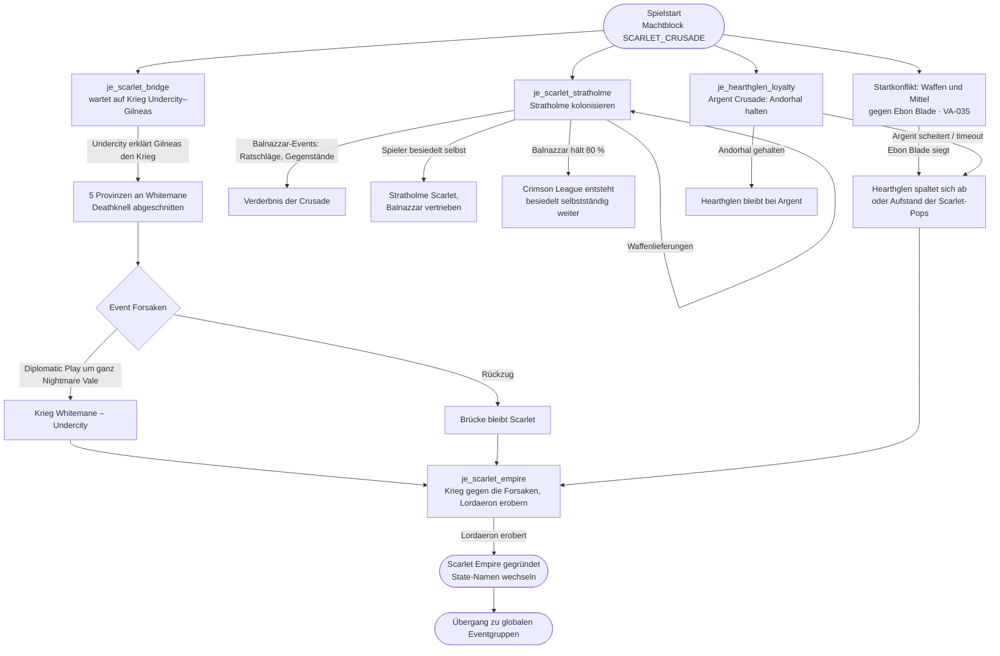

# Ablauf: Scarlet Crusade (Whitemane) – VA-041, VA-035

Entwurf 2026-10-30, überarbeitet nach Konos Vorgaben. Dauern und Aufwand sind Vorschläge von Claude, Kono passt an. Ziel: 25–40 Jahre Inhalt, danach globale Eventgruppen (VA-034).

| Knoten | Bedingung (Auslöser) | Folge | Dauer im Spiel | Aufwand Spieler |
|---|---|---|---|---|
| Startkonflikt | Spielstart, Whitemane im Machtblock | Unterstützung der Ebon-Blade-Gegner; Ergebnis beeinflusst Hearthglen | 2–5 Jahre | gering bis mittel |
| `je_scarlet_bridge` | Undercity im Krieg bzw. Diplomatic Play gegen Gilneas | `xD31E1A xCA3319 x8906CC xF769EE xE4D8D8` an Whitemane; Event für Undercity: Diplomatic Play um den ganzen State oder Rückzug | wartet auf Undercity, danach < 1 Jahr | gering |
| `je_scarlet_stratholme` | ab Start; Stratholme (`PLAGUELAND_UNDEAD`, dezentral) kolonisieren, Waffenlieferungen beschleunigen | Erfolg: Stratholme Scarlet · Balnazzar hält 80 %: Crimson League | 5–15 Jahre | mittel (Entscheidungen bei jedem Balnazzar-Event) |
| Balnazzar-Events | während der Kolonisierung, wiederkehrend | Ratschläge und Gegenstände mit versteckter Verderbnis | über die ganze Kolonisierung | gering je Event |
| `je_hearthglen_loyalty` | Argent Crusade; Hearthglen kümmert sich um Andorhal | Scheitern oder Sieg der Ebon Blade → Abspaltung/Aufstand zu Scarlet | 5–10 Jahre | gering (Argent) |
| `je_scarlet_empire` | Brücke gehalten | Krieg gegen die Forsaken; Ziel: Tirisfal (9 States) + Andorhal, Hearthglen, Sorrow Hill, Forsaken High Command, Forsaken Rear Guard | 10–20 Jahre | hoch |
| Gesamt | | | **ca. 25–40 Jahre** | |

## Offen

- Balnazzar-Events und Verderbnis im Detail (Kono arbeitet aus)
- Wie die 80 % in Stratholme gemessen werden
- Neue State-Namen für Lordaeron nach der Übernahme
- Ablaufdateien für Undercity, Gilneas, Argent Crusade und Ebon Blade
