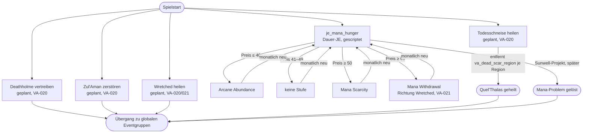

# Ablauf: Silvermoon (Quel'Thalas) – VA-019, VA-020, VA-021

Entwurf 2026-10-30 nach [konzepte/quel_thalas.md](../konzepte/quel_thalas.md). Dauern und Aufwand sind Vorschläge von Claude, Kono passt an. Ziel: 25–40 Jahre Inhalt, danach globale Eventgruppen (VA-034).

Gilt für alle Länder mit Mana-abhängiger Hauptkultur (`sin_dorei`, `quel_dorei`): Silvermoon, Tranquillien, Wretched. Die übrigen Knoten nur für Silvermoon.

| Knoten | Bedingung (Auslöser) | Folge | Dauer im Spiel | Aufwand Spieler |
|---|---|---|---|---|
| `je_mana_hunger` | Spielstart bzw. sobald eine Hauptkultur Mana-abhängig ist (`va_country_mana_dependent_trigger`); ungültig, wenn das nicht mehr gilt | Monatlich genau eine Stufe nach Mana-Preis im eigenen Markt; Text im JE zeigt die aktuelle Stufe | dauerhaft, bis Sunwell-Projekt (VA-020) | laufend gering: Ley Line Taps bauen, Mana handeln |
| Arcane Abundance | Preis ≤ Grundpreis (40) | Forschung +10 %, Lebensstandard +1 | solange Preis hält | – |
| Mana Scarcity | Preis ≥ +25 % (50) | Lebensstandard −1, Radikale/Loyale aus Lebensstandard +10 % | solange Preis hält | – |
| Mana Withdrawal | Preis ≥ +70 % (68), Maximum +75 % | Lebensstandard −2, Radikale/Loyale +25 %, Sterblichkeit +5 %, Durchsatz −10 % | solange Preis hält | – |
| Deathholme vertreiben | geplant (VA-020) | – | 5–10 Jahre | mittel |
| Zul'Aman zerstören | geplant (VA-020) | – | 5–15 Jahre | hoch |
| Wretched heilen | geplant (VA-020/021) | Vereinigung mit den Wretched | 10–20 Jahre | mittel |
| Todesschneise heilen | geplant (VA-020) | Variable `va_dead_scar_region` je Region entfernen | 10–20 Jahre | mittel |
| Gesamt | | | **ca. 25–40 Jahre** | |

## Offen

- Sunwell-Projekt als Abschluss von `je_mana_hunger` (VA-020)
- Events in `je_mana_hunger`, z. B. bei Eintritt in „Mana Withdrawal“ (erklärendes Event mit Wahl)?
- Reihenfolge und Dauer der vier Silvermoon-Ziele
