# Ablauf: Silvermoon (Quel'Thalas) – VA-019, VA-020, VA-021, VA-046, VA-047

Entwurf 2026-10-30 nach [konzepte/quel_thalas.md](../konzepte/quel_thalas.md). **Stand: Release 2026-11-14 (Commit „Zul Jara und Silvermoon release“), mit dem Script abgeglichen.** Dauern und Werte sind Vorschläge von Claude, soweit nicht als Kono-Test markiert. Ziel: 25–40 Jahre Inhalt, danach globale Eventgruppen (VA-034). Gegenseite: [amani.md](amani.md). Wretched im Detail: [wretched.md](wretched.md).

Gilt für alle Länder mit Mana-abhängiger Hauptkultur (`sin_dorei`, `quel_dorei`): Silvermoon, Tranquillien, Wretched (`je_mana_hunger`, Mana-Aufstand). Die übrigen Knoten nur für Silvermoon.

## Ablauf

```mermaid
flowchart TD
    START([Spielstart]) --> MH[je_mana_hunger<br/>alle Mana-abhängigen Länder]
    START --> DH[je_silvermoon_deathholme]
    START --> ZA[je_silvermoon_zul_aman]
    START --> KO[je_silvermoon_corridor<br/>VA-047]
    START -->|Wretched existieren| WR[je_silvermoon_wretched<br/>VA-021]
    START -->|Quinine erforscht| DS[je_va_dead_scar<br/>alle Besitzer, VA-046]

    %% Mana
    MH -->|monatlich nach Mana-Preis| ST[Arcane Abundance / –<br/>Mana Scarcity / Mana Withdrawal]
    MH -->|Schalter| MASS[Disenchantment, Rationing,<br/>Fauna aussaugen]
    MH -->|Mana knapp ≥ 12 Monate| MU1{{mana_uprising_events.1<br/>Hungry in the Streets}}
    MU1 -->|≥ 24 Monate, Wretched existieren| MU2{{mana_uprising_events.2<br/>Rise of the Wretched: Bürgerkrieg}}
    MU1 -->|≥ 24 Monate, keine Wretched| MU3{{mana_uprising_events.3<br/>Flight to the Ruins: neue Wretched}}
    MH -.->|später| SUN([Sunwell-Projekt: Mana-Problem gelöst])

    %% Deathholme
    DH -->|c:DEATHHOLME existiert nicht mehr| DHW{{silvermoon_events.2<br/>Deathholme Falls}}
    DHW --> DHE([Ghostlands Avenged<br/>Prestige +25, 10 J.])
    DH -->|15 Jahre| DHT([Deathholme Endures<br/>Prestige −10 %, 10 J.])

    %% Zul'Aman
    ZA -->|Zul'Aman + Tor'Watha ganz besitzen| ZAW{{silvermoon_events.3<br/>Zul'Aman Taken}}
    ZAW --> ZAE([Amani Broken, Prestige +25, 10 J.<br/>global va_amani_claims_shattered:<br/>alle Amani-JEs enden])
    ZA -->|20 Jahre| ZAT([Ablauf, kein Malus])

    %% Korridor
    KO -->|Schalter: −100.000, 18 Monate je Etappe<br/>3 Etappen, ruht im Krieg| KOE{{silvermoon_events.4<br/>A Stretch of Road Secured}}
    KOE --> KO
    KO -->|xD536B6 + Grenzprovinz besitzen<br/>per Logistik oder Krieg| KOW{{silvermoon_events.5<br/>The Road Is Open}}
    KOW --> KOWE([Road to Tranquillien<br/>Prestige +10, 10 J.])
    KO -->|Tranquillien-Stadt verloren| KOI([endet still])
    KO -->|8 Jahre| KOT([Ablauf, kein Malus])

    %% Wretched (Details wretched.md)
    WR -->|Bedrohung ≥ 50, zufällig| RA{{Raubzüge wretched_events.10–15}}
    WR -->|Bedrohung 100| FR{{wretched_events.17<br/>The Wretched March: Krieg}}
    WR -->|Kopfgeld-Schalter je Anführer| BO{{wretched_bounty_events.1–5}}
    BO -->|alle drei Anführer tot| BOL{{wretched_bounty_events.6<br/>The Wretched Fall Apart}}
    WR -->|Schalter Mana-Pakt| WP{{wretched_events.1<br/>A Pact Offered, bei den Wretched}}
    WP -->|annehmen| WPA{{wretched_events.2}} --> WS[Protektorat]
    WP -->|ablehnen| WPB{{wretched_events.3}} --> WR
    WS -->|Schalter Eingliedern| WA{{wretched_events.4<br/>The Wretched Absorbed}}
    WS -->|Schalter Heilen: 3 Etappen| WH[Heilung<br/>wretched_heal_events.1–3]
    WH --> WU{{wretched_events.5<br/>The Wretched Healed}}
    WR -->|Krieg gegen das eigene Volk| WK{{wretched_events.16<br/>War against Our Own}}
    WA & WU & BOL & WK --> WE([Wretched vereint bzw. erobert])
    WA & BOL & WK -.->|Sucht im Land, alle 2 J.| PL{{wretched_heal_events.4<br/>Plunder of the Mana Stores}}
    WR -->|20 Jahre| WT([Wretched Neglected<br/>Prestige −10 %, 10 J.])

    %% Todesschneise
    DS -->|Schalter je Region: Ritual Site,<br/>20 aktive Monate| DS1{{dead_scar_events.1<br/>The Scar Recedes}}
    DS1 --> DS
    DS -->|keine Region mehr auf der Schneise| DS2{{dead_scar_events.2<br/>The Dead Scar is cleansed}}
    DS2 --> DSF([Land Restored<br/>Prestige +50, 20 J.])

    DHE & DHT & ZAE & ZAT & KOWE & KOT & WE & WT & DSF & SUN --> GLOBAL([Übergang zu globalen Eventgruppen VA-034])
```

Sechseck = Event, Rechteck = JE oder Zustand, abgerundet = Ende.

## Journal Entries

| JE | Start | Erfüllt | Fehlschlag / Ablauf | Dauer | Aufwand |
|---|---|---|---|---|---|
| `je_mana_hunger` (`va_mana.txt`, VA-019) | Hauptkultur Mana-abhängig (`va_country_mana_dependent_trigger`); ungültig, wenn nicht mehr | – (später Sunwell-Projekt) | – | dauerhaft | laufend gering |
| `je_silvermoon_deathholme` | Spielstart; Ansprüche auf Deathholme, Windrunner Village, Tranquillien, East Sanctum, Suncrown Village | `c:DEATHHOLME` existiert nicht mehr → `silvermoon_events.2`, `va_silvermoon_ghostlands_avenged` (Prestige +25, 10 J.) | 15 J. → `va_silvermoon_deathholme_endures` (Prestige −10 %, 10 J.) | gedacht 5–10 J. | mittel: ein, zwei Kriege |
| `je_silvermoon_zul_aman` | Spielstart; Ansprüche auf Zul'Aman, Tor'Watha | beide ganz besitzen → `silvermoon_events.3`, `va_silvermoon_amani_broken` (Prestige +25, 10 J.), setzt `va_amani_claims_shattered` | 20 J., kein Malus | gedacht 5–15 J. | hoch: Krieg gegen Zul'Jarra |
| `je_silvermoon_corridor` (VA-047) | Spielstart | Schalter: −100.000 einmalig, laufend Bürokratie −50, Autorität −25 (`va_silvermoon_corridor_logistics`); je Etappe 18 Monate, ruht im Krieg → `silvermoon_events.4`. Erfüllt, wenn `xD536B6` und eine Grenzprovinz Silvermoon (oder Untertan) gehören → `silvermoon_events.5`, `va_silvermoon_road_to_tranquillien` (Prestige +10, 10 J.) | Tranquillien-Stadt `x1437EA` verloren → endet still; 8 J. → kein Malus | gedacht 4,5–5 J. | gering bis mittel |
| `je_silvermoon_wretched` (VA-021) | Spielstart, solange `WRETCHED_BLOODELFES` existiert; sonst sobald `mana_uprising_events.3` neue Wretched erzeugt | `va_wretched_united` (Eingliedern, Heilen oder Führungslos) | Wretched anders untergegangen → still, Eroberungsfolgen nur bei eigenem Besitz; 20 J. → `va_silvermoon_wretched_neglected` (Prestige −10 %, 10 J.) | Eingliedern 1–2 J., Heilen 5–6 J. | gering bis mittel |
| `je_va_dead_scar` (`va_dead_scar.txt`, VA-046) | jedes Land mit Schneisen-State und Technologie Quinine | Region geheilt → `dead_scar_events.1`; ganze Schneise → `dead_scar_events.2`, Land Restored (Prestige +50, 20 J.) | kein `timeout` | 20 Monate je Region, parallel | mittel bis hoch |

### Mana-Maßnahmen in `je_mana_hunger`

| Maßnahme | Wirkung |
|---|---|
| Stufen (monatlich) | Arcane Abundance (Preis ≤ 40: Forschung +10 %, Lebensstandard +1), keine Stufe (41–49), Mana Scarcity (≥ 50: Lebensstandard −1, Radikale +10 %), Mana Withdrawal (≥ 68: Lebensstandard −2, Radikale +25 %, Sterblichkeit +5 %, Durchsatz −10 %) |
| Mana Upkeep | 3,0 Mana je 100.000 Blut-/Hochelfen als Kaufaufträge im State, minus Abschläge (höchstens −100 %). Silvermoon zum Start rund 170 gegen 80 vom Start-Tap |
| Disenchantment | Schalter: 10 Mana für 1 Jahr, Prestige −10 für 2 Jahre, 2 Jahre gesperrt |
| Mana Rationing | Schalter an/aus: −25 % Bedarf, Lebensstandard −1, Radikale beim Einschalten und alle 6 Monate; nach dem Abschalten 1 Jahr gesperrt |
| Fauna aussaugen | Schalter je Eversong-Region (7): −15 % Bedarf für 1 Jahr; Agrar −30/−20/−10 % über 5 Jahre, stapelbar, nach 1,5 Jahren erneut |
| Mana-Aufstand | Zähler `va_mana_shortage_months` (aus `va_update_mana_dependency_effect`): ab 12 Monaten Warnung, ab 24 Aufstand bzw. Flucht |

## Alle Events auf einen Blick

| Event | Titel | Auslöser | Optionen / Folge |
|---|---|---|---|
| `silvermoon_events.2` | Deathholme Falls | `je_silvermoon_deathholme` erfüllt | „Quel'Thalas is avenged.“ |
| `silvermoon_events.3` | Zul'Aman Taken | `je_silvermoon_zul_aman` erfüllt | „Let the forests know peace.“ |
| `silvermoon_events.4` | A Stretch of Road Secured | Korridor-Etappe fertig (`va_silvermoon_corridor_effects.txt`) | Provinzen der Etappe gehen an Silvermoon |
| `silvermoon_events.5` | The Road Is Open | `je_silvermoon_corridor` erfüllt | „Quel'Thalas is united once more.“ |
| `wretched_events.1` | A Pact Offered | Schalter Mana-Pakt, Event bei den Wretched | a) annehmen → `.2`, Protektorat, Bedrohung −30 · b) ablehnen → `.3`, Bedrohung +5, 1 J. Sperre |
| `wretched_events.2` | The Wretched Accept | Antwort an Silvermoon | Info |
| `wretched_events.3` | The Wretched Refuse | Antwort an Silvermoon | Info |
| `wretched_events.4` | The Wretched Absorbed | Schalter Eingliedern | Annexion; Silvermoon 10 J. Unruhe, States 10 J. „Wretched Addicts“ |
| `wretched_events.5` | The Wretched Healed | Heilung Etappe 3 fertig | Vereinigung ohne Folgen, Prestige +25 |
| `wretched_events.10` | Slain by the Wretched | Bedrohung ≥ 50, Zufall | a) Patrouillen · b) Waren per Schiff |
| `wretched_events.11` | Unstable Mana Crystals | Bedrohung ≥ 50, Zufall | a) Suchtrupps · b) vertuschen → nach 6 Monaten `.14` |
| `wretched_events.12` | Roadside Ambush | Bedrohung ≥ 50, Zufall | a) Lehrlinge bestrafen · b) Akademie bewachen |
| `wretched_events.13` | Situation at Sunsail Anchorage | Bedrohung ≥ 50, Zufall | a) Docks aufgeben · b) Kapitänin Kelisendra anheuern |
| `wretched_events.14` | Explosion at the City Wall | Folge von `.11` b | a) Bresche schließen · b) Volk die Tat zeigen |
| `wretched_events.15` | Apprentices Fall to the Hunger | Mana-Knappheit in Silvermoon | a) Akademien mit Mana versorgen · b) Süchtige verbannen |
| `wretched_events.16` | War against Our Own | Wretched im Krieg erobert | Eroberungsfolgen |
| `wretched_events.17` | The Wretched March | Bedrohung 100 → Wretched greifen an (`va_wretched_frenzy_1–3`) | „Hold the line.“ |
| `wretched_heal_events.1` | The First to Recover | Heil-Etappe 1 fertig, Sucht −1 | Info |
| `wretched_heal_events.2` | Their Eyes Grow Clear | Heil-Etappe 2 fertig, Sucht −1 | a) zu den Rangern · b) in die Werkstätten |
| `wretched_heal_events.3` | Relapse | Mana-Entzug bei den Wretched während der Heilung | a) Notlieferung (Geld) · b) −6 Monate Fortschritt |
| `wretched_heal_events.4` | Plunder of the Mana Stores | „Wretched Addicts“ im Land, alle 2 J. | a) hart durchgreifen (Radikale) · b) versorgen −25.000, ein State geheilt |
| `wretched_bounty_events.1` | WANTED: Thaelis the Hungerer | Kopfgeld Thaelis erfolgreich | Anführer tot |
| `wretched_bounty_events.2` | The Hunt Has Failed | Kopfgeld 12 Monate ohne Erfolg | Bedrohung +10 |
| `wretched_bounty_events.3` | The Ringleader Falls | Kopfgeld Aldaron erfolgreich | Hafen wieder offen |
| `wretched_bounty_events.4` | Felendren the Banished | Kopfgeld Felendren erfolgreich | a) Splitter an Helion (`va_tainted_sliver_kept`, VA-056) · b) zerstören |
| `wretched_bounty_events.5` | The Wretched Take Revenge | nach einem getöteten Anführer | Rache-Raubzug |
| `wretched_bounty_events.6` | The Wretched Fall Apart | alle drei Anführer tot | Annexion, Verwüstung 50 in den Wretched-States |
| `mana_uprising_events.1` | Hungry in the Streets | 12 Monate Mana-Knappheit (alle Mana-Länder) | a) Notvorräte öffnen · b) Wachen verstärken |
| `mana_uprising_events.2` | Rise of the Wretched | 24 Monate, Wretched existieren | Bürgerkrieg (`dp_annex_war`, als Bürgerkrieg) |
| `mana_uprising_events.3` | Flight to the Ruins | 24 Monate, keine Wretched | Süchtige fliehen, neue Wretched |
| `dead_scar_events.1` | The Scar Recedes | Ritual Site einer Region fertig | Region geheilt |
| `dead_scar_events.2` | The Dead Scar is cleansed. | ganze Schneise geheilt | Land Restored |

Zul'Jarras Events (`amani_*`) stehen in [amani.md](amani.md).

## Offen

- Mana-Maßnahmen (Kono 2026-11-12): Werte sind Vorschläge von Claude. Später ggf. „Siphon Fel Crystals“ (Kael'thas, VA-056) und weitere Mana-Kreaturen.
- Sunwell-Projekt als Abschluss von `je_mana_hunger` (VA-020).
- Events in `je_mana_hunger`, z. B. bei Eintritt in „Mana Withdrawal“ (erklärendes Event mit Wahl)?
- `je_silvermoon_zul_aman` ist noch die alte Form (Zul'Aman + Tor'Watha besitzen). Umbau auf „zurücktreiben und einsperren“ zusammen mit `je_amani_siege` (siehe [amani.md](amani.md)).
- Spielt Kono die Wretched selbst, gibt es bisher nur das Pakt-Event; Wretched-Seite zurückgestellt bis VA-056.
- Übergeordnete JE „Wiederherstellung Quel'Thalas“ (zählt erfüllte Ziele, Vorbild `je_sick_man_main`)?
- Abschluss-Events für Ablauf und Fehlschlag fehlen (Deathholme Endures, Wretched Neglected laufen ohne Popup).
