# Ablauf: Silvermoon (Quel'Thalas) – VA-019, VA-020, VA-021, VA-046, VA-047

Entwurf 2026-10-30 nach [konzepte/quel_thalas.md](../konzepte/quel_thalas.md). Dauern und Aufwand sind Vorschläge von Claude, Kono passt an. Ziel: 25–40 Jahre Inhalt, danach globale Eventgruppen (VA-034).

Gilt für alle Länder mit Mana-abhängiger Hauptkultur (`sin_dorei`, `quel_dorei`): Silvermoon, Tranquillien, Wretched. Die übrigen Knoten nur für Silvermoon.

```mermaid
flowchart TD
    START([Spielstart]) --> MH[je_mana_hunger<br/>Dauer-JE, gescriptet]
    START --> DH[je_silvermoon_deathholme<br/>gescriptet, VA-020]
    START --> ZA[je_silvermoon_zul_aman<br/>gescriptet, VA-020]
    START --> KO[je_silvermoon_corridor<br/>gescriptet, VA-047]
    KO -->|Schalter: −100.000, 18 Monate je Etappe<br/>3 Etappen, ruht im Krieg| KOE[Etappe gesichert<br/>silvermoon_events.4]
    KOE --> KO
    KO -->|xD536B6 + Grenzprovinz besitzen<br/>Logistik oder Krieg, silvermoon_events.5| KOW([Road to Tranquillien<br/>Prestige +10, 10 J.])
    KO -->|8 Jahre| KOT([Ablauf, kein Malus])
    KOW & KOT --> GLOBAL
    START -->|Wretched existieren| WR[je_silvermoon_wretched<br/>gescriptet, VA-021]
    WR -->|Schalter Mana-Pakt, Abkühlung 1 Jahr| WP{wretched_events.1<br/>Wretched entscheiden}
    WP -->|annehmen: Protektorat<br/>wretched_events.2| WS[Wretched Schutzbefohlene]
    WP -->|ablehnen<br/>wretched_events.3| WR
    WS -->|Schalter Eingliedern<br/>wretched_events.4| WA([Annektiert, schnell<br/>Land 10 J. Unruhe, States 10 J. Mana-Süchtige])
    WS -->|Schalter Heilung: −100.000, −10.000/Monat<br/>−25 Bürokratie| WH[Heilung läuft<br/>Balken +1/Monat, ruht bei Mana-Knappheit<br/>der Wretched oder im Krieg]
    WH -->|Balken 60/60<br/>wretched_events.5| WU([Vereinigt, ohne Folgen<br/>Prestige +25, 10 J.])
    WH -->|Schalter Eingliedern| WA
    WR -->|20 Jahre| WT([Ablauf, kein Malus])
    START -->|Quinine erforscht| DS[je_va_dead_scar<br/>alle Besitzer, VA-046]

    MH -->|Preis ≤ 40| AB[Arcane Abundance]
    MH -->|Preis 41–49| NO[keine Stufe]
    MH -->|Preis ≥ 50| SC[Mana Scarcity]
    MH -->|Preis ≥ 68| WD[Mana Withdrawal<br/>Richtung Wretched, VA-021]
    AB & NO & SC & WD -->|monatlich neu| MH
    MH -->|Sunwell-Projekt, später| SUN([Mana-Problem gelöst])
    MH -->|Grundbedarf je Elf, extrem hoch| UP[Mana Upkeep je State]
    MH -->|Schalter, 2 J. gesperrt| DIS[Disenchantment<br/>+10 Mana, 1 Jahr, Prestige −]
    MH -->|Schalter an/aus, dauerhaft| RAT[Mana Rationing<br/>−25 % Bedarf, Lebensstandard −1, Radikale]
    MH -->|Schalter je Eversong-Region| FAU[Fauna aussaugen<br/>−15 % je Region für 1 J., 5 J. Agrar-Malus, stapelbar]
    DIS & RAT & FAU -->|senken| UP

    DS -->|Schalter je Region an/aus| RIT[Ritual Site im State<br/>Start −100.000, Löhne, 15 Mana, 10 Papier, −25 Bürokratie<br/>Balken +1/Monat, ruht bei Mana Withdrawal]
    RIT -->|Balken 20/20<br/>dead_scar_events.1| DS
    DS -->|keine Region mehr auf der Schneise<br/>dead_scar_events.2| DSF([Land Restored<br/>Prestige +50, 20 J.])
    DH -->|Deathholme existiert nicht mehr<br/>silvermoon_events.2| DHW([Ghostlands Avenged<br/>Prestige +25, 10 J.])
    DH -->|15 Jahre| DHT([Deathholme Endures<br/>Prestige −10 %, 10 J.])
    ZA -->|Zul'Aman + Tor Watha besitzen<br/>silvermoon_events.3| ZAW([Amani Broken, Prestige +25<br/>global_var:va_amani_claims_shattered])
    ZA -->|20 Jahre| ZAT([Ablauf, kein Malus])
    DHW & DHT --> GLOBAL([Übergang zu globalen Eventgruppen])
    ZAW & ZAT --> GLOBAL
    DSF --> GLOBAL
    WA & WU & WT --> GLOBAL
    DSF --> GLOBAL
    SUN --> GLOBAL
```

| Knoten | Bedingung (Auslöser) | Folge | Dauer im Spiel | Aufwand Spieler |
|---|---|---|---|---|
| `je_mana_hunger` | Spielstart bzw. sobald eine Hauptkultur Mana-abhängig ist (`va_country_mana_dependent_trigger`); ungültig, wenn das nicht mehr gilt | Monatlich genau eine Stufe nach Mana-Preis im eigenen Markt; Text im JE zeigt die aktuelle Stufe | dauerhaft, bis Sunwell-Projekt (VA-020) | laufend gering: Ley Line Taps bauen, Mana handeln |
| Arcane Abundance | Preis ≤ Grundpreis (40) | Forschung +10 %, Lebensstandard +1 | solange Preis hält | – |
| Mana Scarcity | Preis ≥ +25 % (50) | Lebensstandard −1, Radikale/Loyale aus Lebensstandard +10 % | solange Preis hält | – |
| Mana Withdrawal | Preis ≥ +70 % (68), Maximum +75 % | Lebensstandard −2, Radikale/Loyale +25 %, Sterblichkeit +5 %, Durchsatz −10 % | solange Preis hält | – |
| `je_silvermoon_deathholme` | Spielstart (Silvermoon); Ansprüche auf Deathholme, Windrunner Village, Tranquillien, East Sanctum, Suncrown Village | Erfüllt, wenn `c:DEATHHOLME` nicht mehr existiert → `silvermoon_events.2`, Ghostlands Avenged (Prestige +25, 10 J.). Ablauf → Deathholme Endures (Prestige −10 %, 10 J.) | `timeout` 15 Jahre, gedacht 5–10 | mittel: ein, zwei Kriege |
| `je_silvermoon_zul_aman` | Spielstart (Silvermoon); Ansprüche auf Zul'Aman, Tor Watha | Erfüllt bei vollem Besitz beider → `silvermoon_events.3`, Amani Broken (Prestige +25, 10 J.), sperrt Amani-Formable über `va_amani_claims_shattered` | `timeout` 20 Jahre, gedacht 5–15 | hoch: Krieg gegen Zul'Jarra |
| `je_silvermoon_corridor` (VA-047) | Spielstart (Silvermoon) | Schalter startet Logistik-Operation (−100.000 einmalig, Bürokratie −50, Autorität −25 laufend); nach 18 Monaten übernimmt Silvermoon die Provinzen der Etappe von Deathholme (`silvermoon_events.4`). Erfüllt, sobald Silvermoon-Seite `xD536B6` und eine Grenzprovinz besitzt, auch per Krieg → `silvermoon_events.5`, Road to Tranquillien (Prestige +10, 10 J.) | `timeout` 8 Jahre, gedacht 4,5–5 | gering bis mittel: drei Klicks, Kosten tragen, Frieden halten |
| `je_silvermoon_wretched` (VA-021, Details und Ausbau: [wretched.md](wretched.md)) | Spielstart (Silvermoon), solange `WRETCHED_BLOODELFES` existiert. Wretched tragen `va_wretched_addiction` | Schritt 1: Schalter „Mana-Pakt“ → `wretched_events.1` bei den Wretched (KI nimmt eher an, wenn ihr Mana knapp ist) → Protektorat. Schritt 2, Wahl: **Eingliedern** (`wretched_events.4`, sofort `annex_with_incorporation`, Silvermoon 10 J. `va_silvermoon_wretched_absorbed`, Wretched-States 10 J. `va_wretched_addicts`) oder **Heilen** (−100.000 einmalig, −10.000 je Monat, Bürokratie −25; Balken 60 Monate, läuft nur, solange Mana im Markt der Wretched nicht knapp ist und kein Krieg herrscht → `wretched_events.5`, Vereinigung ohne Folgen, Prestige +25 für 10 J.) | `timeout` 20 Jahre; Eingliedern 1–2 Jahre, Heilen 6–8 Jahre | gering (Eingliedern) bis mittel (Heilen: Kosten, Mana an die Wretched liefern) |
| `je_va_dead_scar` (VA-046) | Jedes Land mit Schneisen-State **und Technologie Quinine** (Ära 2), spätestens einen Monat nach Forschung bzw. bei Besitzwechsel | Je Region Schalter: Ritual Site (Start −100.000, Löhne, 15 Mana, 10 Papier, −25 Bürokratie). 20 aktive Monate → `dead_scar_events.1` heilt die Region; ganze Schneise → `dead_scar_events.2`, Land Restored (Prestige +50, 20 J.) | 20 Monate je Region, parallel möglich; kein `timeout` | mittel bis hoch: laufende Kosten, Mana-Versorgung, Eroberung der Deathholme-States |
| Mana Upkeep (Grundbedarf) | jedes Land mit `je_mana_hunger`, monatlich | 3,0 Mana je 100.000 Blut-/Hochelfen als Kaufaufträge im State (`va_mana_upkeep`), minus laufende Abschläge (höchstens −100 %). Silvermoon zum Start rund 170 gegen 80 vom Start-Tap | dauerhaft | laufend: Taps bauen, Schalter nutzen |
| Disenchantment | Schalter im Mana-JE | Werkstatt in der Hauptstadt erzeugt 10 Mana für 1 Jahr; Prestige −10 für 2 Jahre (zerstörtes Kulturerbe). 2 Jahre gesperrt | 1 Jahr | gering, kostet Ansehen |
| Mana Rationing | Schalter an/aus im Mana-JE | −25 % Bedarf, solange an; Lebensstandard −1, beim Einschalten und alle 6 Monate feste Radikale. Dauerhaft haltbar; nach dem Abschalten 1 Jahr gesperrt | beliebig | mittel: Unruhe tragen |
| Fauna aussaugen | Schalter je eigener Eversong-Region (Sunstrider Isle, Ruins of Silvermoon, Farstrider Retreat, Duskwither Spire, West Sanctum, East Sanctum, Sunsail Anchorage) | −15 % Bedarf je Region für 1 Jahr (7 Regionen bis über 100 %). Region: Agrar-Durchsatz −30 % (1,5 J.), −20 % (bis 3 J.), −10 % (bis 5 J.). Nach 1,5 J. erneut möglich, Malusse stapeln (vier Modifier-Sätze) | 1 Jahr je Region | mittel: Agrar-Verlust |
| Gesamt | | | **ca. 25–40 Jahre** | |

## Offen

- Mana-Maßnahmen (Kono 2026-11-12): Werte sind Vorschläge von Claude. Später ggf. „Siphon Fel Crystals“ (Kael'thas, VA-056) und weitere Mana-Kreaturen

- Sunwell-Projekt als Abschluss von `je_mana_hunger` (VA-020)
- Events in `je_mana_hunger`, z. B. bei Eintritt in „Mana Withdrawal“ (erklärendes Event mit Wahl)?
- Reihenfolge und Dauer der Silvermoon-Ziele: alle drei laufen parallel ab Spielstart (Vorschlag Claude, Kono bestätigt oder ändert). Werte (Kosten, Prestige, Abläufe) noch nicht bestätigt
- VA-021: Sucht der Wretched (`va_wretched_addiction`) bleibt bis zur Vereinigung unverändert; soll der Pakt oder der Heilbalken sie stufenweise senken? Werte (Kosten, 60 Monate, Folgen des Eingliederns) sind Vorschläge von Claude
- VA-021: Spielt Kono die Wretched selbst, gibt es bisher nur das Pakt-Event; eigenes Wretched-JE (z. B. um Silvermoon werben oder Unabhängigkeit) offen
- Übergeordnete JE „Wiederherstellung Quel'Thalas“ (zählt erfüllte Ziele, Vorbild `je_sick_man_main`)? Erst mit VA-021, wenn alle Ziele stehen
