# Ablauf: Silvermoon (Quel'Thalas) – VA-019, VA-020, VA-021

Entwurf 2026-10-30 nach [konzepte/quel_thalas.md](../konzepte/quel_thalas.md). Dauern und Aufwand sind Vorschläge von Claude, Kono passt an. Ziel: 25–40 Jahre Inhalt, danach globale Eventgruppen (VA-034).

Gilt für alle Länder mit Mana-abhängiger Hauptkultur (`sin_dorei`, `quel_dorei`): Silvermoon, Tranquillien, Wretched. Die übrigen Knoten nur für Silvermoon.

```mermaid
flowchart TD
    START([Spielstart]) --> MH[je_mana_hunger<br/>Dauer-JE, gescriptet]
    START --> DH[je_silvermoon_deathholme<br/>gescriptet, VA-020]
    START --> ZA[je_silvermoon_zul_aman<br/>gescriptet, VA-020]
    START --> KO[je_silvermoon_corridor<br/>gescriptet, VA-047]
    KO -->|Schalter: −100.000, 18 Monate je Etappe<br/>3 Etappen, ruht im Krieg| KOE[Etappe gesichert<br/>silvermoon_events.4]
    KOE --> KO
    KO -->|xD536B6 + Grenzprovinz besitzen<br/>Logistik oder Krieg, silvermoon_events.5| KOW([Road to Tranquillien<br/>Prestige +10, 10 J.])
    KO -->|8 Jahre| KOT([Ablauf, kein Malus])
    KOW & KOT --> GLOBAL
    START --> WR[Wretched heilen<br/>geplant, VA-021]
    START -->|Quinine erforscht| DS[je_va_dead_scar<br/>alle Besitzer, VA-046]

    MH -->|Preis ≤ 40| AB[Arcane Abundance]
    MH -->|Preis 41–49| NO[keine Stufe]
    MH -->|Preis ≥ 50| SC[Mana Scarcity]
    MH -->|Preis ≥ 68| WD[Mana Withdrawal<br/>Richtung Wretched, VA-021]
    AB & NO & SC & WD -->|monatlich neu| MH
    MH -->|Sunwell-Projekt, später| SUN([Mana-Problem gelöst])

    DS -->|Schalter je Region an/aus| RIT[Ritual Site im State<br/>Start −100.000, Löhne, 15 Mana, 10 Papier, −25 Bürokratie<br/>Balken +1/Monat, ruht bei Mana Withdrawal]
    RIT -->|Balken 20/20<br/>dead_scar_events.1| DS
    DS -->|keine Region mehr auf der Schneise<br/>dead_scar_events.2| DSF([Land Restored<br/>Prestige +50, 20 J.])
    DH -->|Deathholme existiert nicht mehr<br/>silvermoon_events.2| DHW([Ghostlands Avenged<br/>Prestige +25, 10 J.])
    DH -->|15 Jahre| DHT([Deathholme Endures<br/>Prestige −10 %, 10 J.])
    ZA -->|Zul'Aman + Tor Watha besitzen<br/>silvermoon_events.3| ZAW([Amani Broken, Prestige +25<br/>global_var:va_amani_claims_shattered])
    ZA -->|20 Jahre| ZAT([Ablauf, kein Malus])
    DHW & DHT --> GLOBAL([Übergang zu globalen Eventgruppen])
    ZAW & ZAT --> GLOBAL
    DSF --> GLOBAL
    WR --> GLOBAL
    DSF --> GLOBAL
    SUN --> GLOBAL
```

| Knoten | Bedingung (Auslöser) | Folge | Dauer im Spiel | Aufwand Spieler |
|---|---|---|---|---|
| `je_mana_hunger` | Spielstart bzw. sobald eine Hauptkultur Mana-abhängig ist (`va_country_mana_dependent_trigger`); ungültig, wenn das nicht mehr gilt | Monatlich genau eine Stufe nach Mana-Preis im eigenen Markt; Text im JE zeigt die aktuelle Stufe | dauerhaft, bis Sunwell-Projekt (VA-020) | laufend gering: Ley Line Taps bauen, Mana handeln |
| Arcane Abundance | Preis ≤ Grundpreis (40) | Forschung +10 %, Lebensstandard +1 | solange Preis hält | – |
| Mana Scarcity | Preis ≥ +25 % (50) | Lebensstandard −1, Radikale/Loyale aus Lebensstandard +10 % | solange Preis hält | – |
| Mana Withdrawal | Preis ≥ +70 % (68), Maximum +75 % | Lebensstandard −2, Radikale/Loyale +25 %, Sterblichkeit +5 %, Durchsatz −10 % | solange Preis hält | – |
| `je_silvermoon_deathholme` | Spielstart (Silvermoon); Ansprüche auf Deathholme, Windrunner Village, Tranquillien, East Sanctum, Suncrown Village | Erfüllt, wenn `c:DEATHHOLME` nicht mehr existiert → `silvermoon_events.2`, Ghostlands Avenged (Prestige +25, 10 J.). Ablauf → Deathholme Endures (Prestige −10 %, 10 J.) | `timeout` 15 Jahre, gedacht 5–10 | mittel: ein, zwei Kriege |
| `je_silvermoon_zul_aman` | Spielstart (Silvermoon); Ansprüche auf Zul'Aman, Tor Watha | Erfüllt bei vollem Besitz beider → `silvermoon_events.3`, Amani Broken (Prestige +25, 10 J.), sperrt Amani-Formable über `va_amani_claims_shattered` | `timeout` 20 Jahre, gedacht 5–15 | hoch: Krieg gegen Zul'Jarra |
| `je_silvermoon_corridor` (VA-047) | Spielstart (Silvermoon) | Schalter startet Logistik-Operation (−100.000 einmalig, Bürokratie/Autorität −25 laufend); nach 18 Monaten übernimmt Silvermoon die Provinzen der Etappe von Deathholme (`silvermoon_events.4`). Erfüllt, sobald Silvermoon-Seite `xD536B6` und eine Grenzprovinz besitzt, auch per Krieg → `silvermoon_events.5`, Road to Tranquillien (Prestige +10, 10 J.) | `timeout` 8 Jahre, gedacht 4,5–5 | gering bis mittel: drei Klicks, Kosten tragen, Frieden halten |
| Wretched heilen | geplant (VA-020/021) | Vereinigung mit den Wretched | 10–20 Jahre | mittel |
| `je_va_dead_scar` (VA-046) | Jedes Land mit Schneisen-State **und Technologie Quinine** (Ära 2), spätestens einen Monat nach Forschung bzw. bei Besitzwechsel | Je Region Schalter: Ritual Site (Start −100.000, Löhne, 15 Mana, 10 Papier, −25 Bürokratie). 20 aktive Monate → `dead_scar_events.1` heilt die Region; ganze Schneise → `dead_scar_events.2`, Land Restored (Prestige +50, 20 J.) | 20 Monate je Region, parallel möglich; kein `timeout` | mittel bis hoch: laufende Kosten, Mana-Versorgung, Eroberung der Deathholme-States |
| Gesamt | | | **ca. 25–40 Jahre** | |

## Offen

- Sunwell-Projekt als Abschluss von `je_mana_hunger` (VA-020)
- Events in `je_mana_hunger`, z. B. bei Eintritt in „Mana Withdrawal“ (erklärendes Event mit Wahl)?
- Reihenfolge und Dauer der Silvermoon-Ziele: alle drei laufen parallel ab Spielstart (Vorschlag Claude, Kono bestätigt oder ändert). Werte (Kosten, Prestige, Abläufe) noch nicht bestätigt
- Übergeordnete JE „Wiederherstellung Quel'Thalas“ (zählt erfüllte Ziele, Vorbild `je_sick_man_main`)? Erst mit VA-021, wenn alle Ziele stehen
