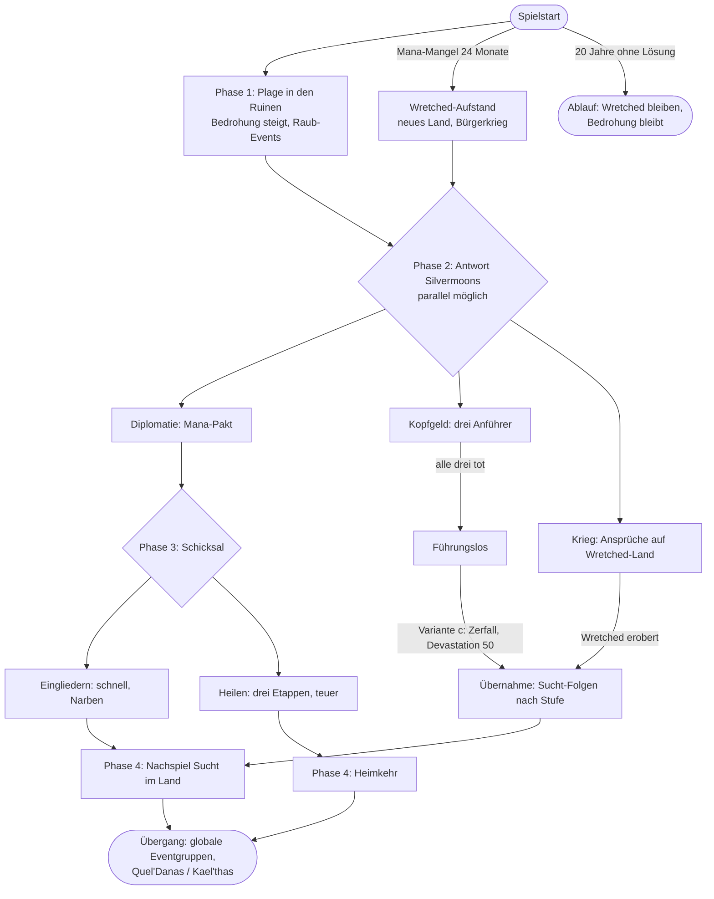
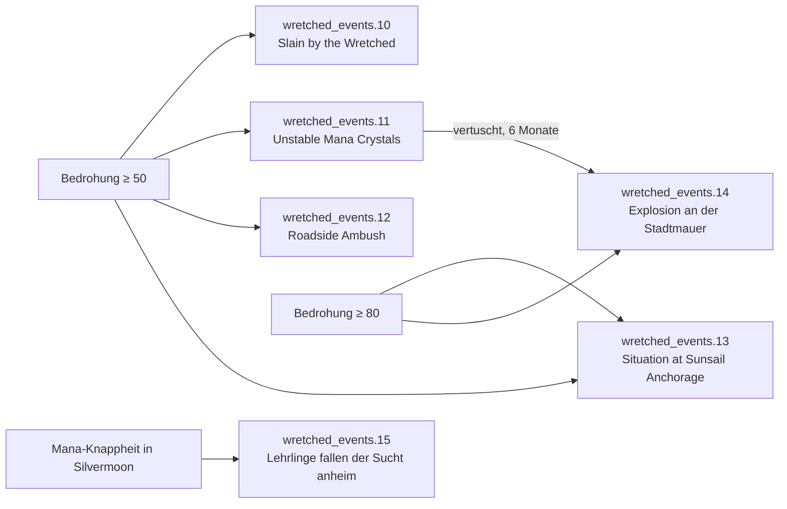
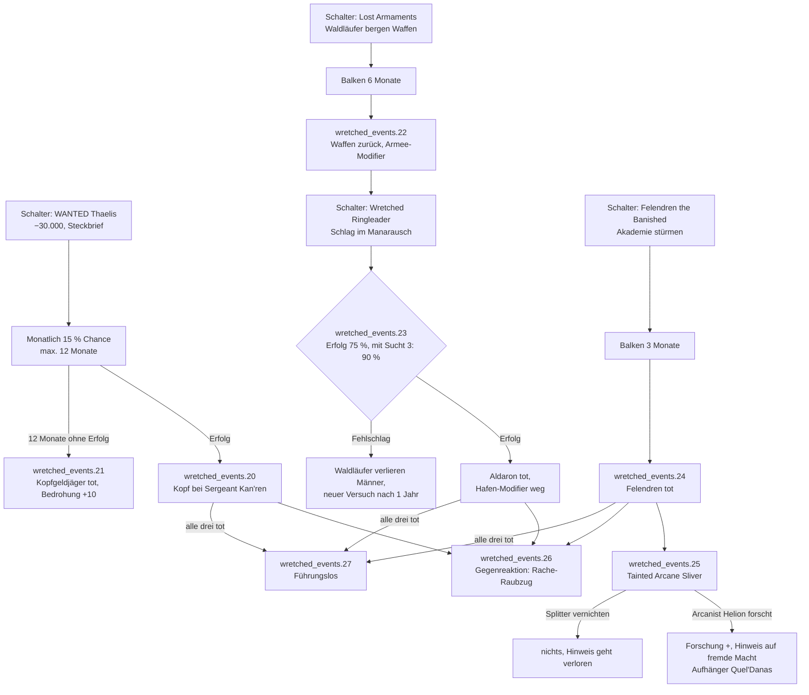
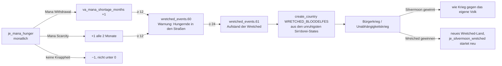
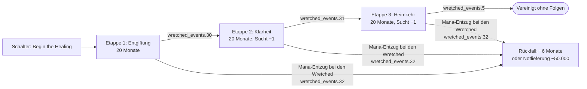
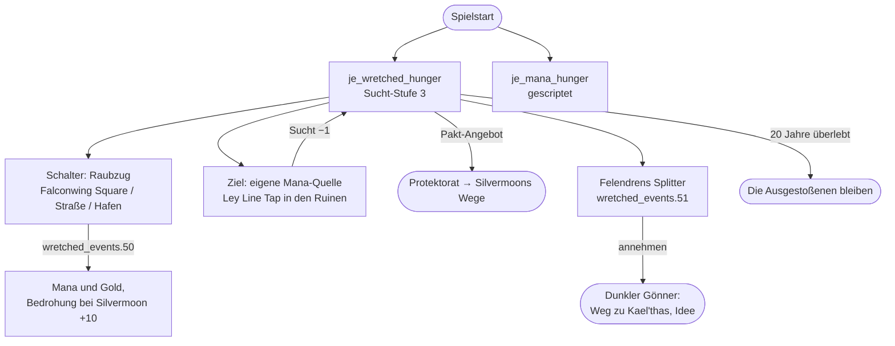

# Ablauf: Wretched (Quel'Thalas) – VA-021

Entwurf 2026-11-03 (zweite Fassung) nach [konzepte/quel_thalas.md](../konzepte/quel_thalas.md) (Abschnitt Wretched) und der Quest-Recherche [recherche/quests_quel_thalas.md](../recherche/quests_quel_thalas.md) („Wretched – Anführer und Banden“). Alle Dauern, Kosten, Chancen und Schwellen sind **Vorschläge von Claude**, Kono passt an.

## Entscheidungen Kono (2026-11-03)

- **Bedrohung** als Kennzahl: übernommen.
- **Führungslos:** Variante c – die Wretched zerfallen, Silvermoon übernimmt, die Regionen sind verwüstet (Devastation ca. 50).
- **Kopfgeld:** erstmal nebenbei, einfach halten. Später evtl. ein eigenes Menü mit Heldengruppen, die Kopfgeld und Dungeons übernehmen (VA-054).
- **Felendren:** Agitator (wichtig, wenn man später die Wretched spielt).
- **Heilen:** in Etappen, je Etappe Landesmodifikatoren für **beide** Länder.
- **Krieg:** Silvermoon hat Ansprüche, aber es ist ein Krieg gegen das eigene Volk. Zusätzlich: Wer das Mana-Problem zu lange ignoriert, bekommt einen neuen Wretched-Aufstand (Bürgerkrieg).
- **Wretched spielbar machen:** später, wenn Kael'thas und die Brennende Legion als Alternative stehen (VA-056). Bis dahin nur Pakt-Event und Gegenwehr per KI.

Status je Knoten: **gescriptet** (im Repo, ungetestet), **Umbau** (gescriptet, muss für diesen Plan angepasst werden), **geplant** (hier ausgearbeitet, noch kein Script), **Idee** (Richtung klar, Details offen), **offen** (Entscheidung Kono).

## Grundidee

Die Wretched sind kein Gegner, den man einmal besiegt, sondern eine **Wunde in der eigenen Gesellschaft**: Elfen, die den Durst nach Magie nicht beherrschen (Quest *Thirst Unending*, 37439). Solange sie hungern, plündern sie Silvermoon aus. Silvermoon kann sie bekämpfen (Kopfgeld, Krieg), einbinden (Pakt) und am Ende eingliedern oder heilen. Je gewaltsamer der Weg, desto schneller, aber desto mehr Narben (Radikale, Sucht im eigenen Land). Je geduldiger, desto teurer, aber desto heiler das Ergebnis.

Spielzeit: ca. 1–20 Jahre, je nach Weg. Danach Übergang zu globalen Eventgruppen (VA-034) bzw. zur späteren Quel'Danas-Reihe (Kael'thas).

## Ausgangslage (Spielstart)

| State | Teil der Wretched | Anführer (Wowhead-NPC) | Quest-Vorlage | Rolle im Plan |
|---|---|---|---|---|
| `STATE_RUINS_OF_SILVERMOON` (Hauptstadt) | großer Teil, Silvermoon hält den Rest | Thaelis the Hungerer (15949) | WANTED: Thaelis the Hungerer (8468) | Herrscher, Banden der Ruinen |
| `STATE_SUNSAIL_ANCHORAGE` (Hafen) | Teil, daneben Silvermoon und Grimscale | Aldaron the Reckless (16294) | Situation at Sunsail Anchorage (8892), Lost Armaments (8480), Wretched Ringleader (9076) | General, hält den Hafen und die Waffen der Waldläufer |
| `STATE_SUNSTRIDER_ISLE` (Startgebiet) | Teil, Silvermoon hält die Sonnenturm-Seite | Felendren the Banished (15367) | Felendren the Banished (8335), Tainted Arcane Sliver (8338) | **Agitator** (Kono), Arkangeister in der Falthrien-Akademie; später Brücke zu Kael'thas/Legion (VA-056) |

Banden der Ruinen (Flavour, Event-Texte): Wretched Urchin (15644), Wretched Thug (15645), Wretched Hooligan (16162).

**Zwei Kennzahlen** (neu, geplant) tragen den ganzen Ablauf:

| Kennzahl | Träger | Bereich | Steigt durch | Sinkt durch | Wirkung |
|---|---|---|---|---|---|
| **Bedrohung** `va_wretched_threat` (bestätigt) | Silvermoon (Variable) | 0–100, Start 40 | monatlich +1, solange Mana im Markt der Wretched knapp ist; erfolgreiche Raubzüge; gescheiterte Kopfgeldjagd | Anführer getötet (−20), Pakt (−30), jeder Monat Heilung (−1), Patrouillen-Option in Events | Ab 50 Raub-Events (Phase 1), ab 80 schwere Events (Explosion, Hafen verloren). **Gescriptet** als Balken `va_silvermoon_wretched_threat_bar` (2026-11-03); Kopfgeld-Werte folgen mit Schritt 3 |
| **Sucht** `va_wretched_addiction_level` (gescriptet 2026-11-03) | Wretched (Variable, Stufen 1–3) | 3 = verzweifelt, 2 = süchtig, 1 = gezügelt | Mana-Entzug im Markt der Wretched (alle 12 Monate +1) | Pakt (Mana-Lieferungen, −1 nach 12 Monaten Versorgung), Heilungs-Etappen | ersetzt den festen Modifier `va_wretched_addiction` durch drei Stufen; Stufe bestimmt Folgen beim Eingliedern |

## Überblick

## Phase 1 – Plage in den Ruinen (Jahr 0–3, läuft bis zur Lösung)

**Status: gescriptet (2026-11-03)**, `va_silvermoon_wretched_raid_effect`. Abweichungen vom Entwurf: `.13` b) Kelisendra anheuern (−30.000, Hafen nur 2 J. gesperrt) statt nur Flavour; `.14` a) Mauer schließen (−20.000, 1 J.) oder b) offen lassen (2 J., Radikale), ohne Legitimität; „Hafen überrannt“ läuft vorerst 5 J. (Ende durch Aldarons Tod mit Schritt 3).

Die Wretched hungern und plündern. Monatlich prüft `je_silvermoon_wretched`, ob ein Raub-Event fällig ist (Chance je nach Bedrohung, höchstens eines je 6 Monate, Vorbild: zufällige Events per `on_monthly_pulse` mit `random`). Jedes Event stammt aus einer Quest.

| Event | Quest-Vorlage (ID) | Auslöser | Optionen (Vorschlag) |
|---|---|---|---|
| `.10` Slain by the Wretched | 9704, 9705, 8350 | Bedrohung ≥ 50 | a) **Patrouillen** auf der Straße: −25.000, Bedrohung −10. b) **Umweg** über das Meer: Modifier „Unsichere Straße“ auf Silvermoon (Marktzugang Sunstrider Isle −, 2 Jahre) |
| `.11` Unstable Mana Crystals | 8463 | Bedrohung ≥ 50 | a) **Suchtrupp** der Wache (Aeldon Sunbrand): −15.000, Kristalle zurück. b) **Vertuschen**, damit die Wache nicht schlecht dasteht: nichts sofort, aber nach 6 Monaten 50 % Chance auf `.14` |
| `.12` Roadside Ambush | 9035, 9062, 9064, 9066 | Bedrohung ≥ 50 | a) **Lehrlinge bestrafen** (Instructor Antheol): Intelligenzija-Zustimmung +, Bedrohung unverändert. b) **Wachen zur Akademie**: −10.000, Bedrohung −5 |
| `.13` Situation at Sunsail Anchorage | 8892, 8886 | Bedrohung ≥ 80 oder Zufall | Wretched überrennen den Hafen. Silvermoons Teil von Sunsail: Modifier „Hafen überrannt“ (Hafen/Handel −, bis Aldaron tot ist). Nebenbei stehlen Grimscale-Murlocs die Ladung (Flavour, Captain Kelisendra) |
| `.14` Explosion an der Stadtmauer | Folge von 8463 | aus `.11` b) oder Bedrohung ≥ 80 | Ein Gebäude in Silvermoon City verliert Stufen bzw. State-Modifier „Bresche“ (Verteidigung −, Unruhe +, 2 Jahre). Legitimität −5 |
| `.15` Lehrlinge fallen der Sucht anheim | Duskwither Spire (8888–8891) | Silvermoon hat `va_mana_scarcity` oder `va_mana_withdrawal` | Ein Teil der Pops in Silvermoon wird unzufrieden; Option a) Mana für die Akademien (Kosten), b) Verbannung (Bedrohung +10: die Verbannten laufen zu den Wretched) |

Aufwand Spieler: gering, Entscheidungen alle paar Jahre. Zweck: Druck aufbauen, damit Phase 2 nicht ignoriert wird.

## Phase 2 – Antwort Silvermoons (ab Jahr 0, Wege parallel)

### 2a Diplomatie: Mana-Pakt (gescriptet, Umbau)

| Knoten | Bedingung | Folge | Status |
|---|---|---|---|
| Schalter „Mana-Pakt“ | Wretched frei, kein Krieg mit ihnen, 1 Jahr Sperre nach Ablehnung | `wretched_events.1` an die Wretched | gescriptet |
| Annahme | KI: Basis 50 %, +40 % bei Mana-Knappheit; +10 % je getötetem Anführer, −30 %, solange Thaelis lebt und Sucht 3 ist | Protektorat, Bedrohung −30, `wretched_events.2` | gescriptet |
| Ablehnung | | `wretched_events.3`, Bedrohung +5 | gescriptet |
| **Neu:** Mana-Lieferungen | Protektorat besteht 12 Monate, Mana im Markt der Wretched nicht knapp | Sucht −1 (höchstens bis 2; Stufe 1 nur durch Heilung) | gescriptet |

### 2b Kopfgeld: drei Anführer (einfache Fassung gescriptet 2026-11-03)

**Gebaut:** je Anführer ein Schalter, monatliche Chance (Thaelis 15 %, Aldaron 20 %, Felendren 25 %), nach 12 Monaten Scheitern. Events in `wretched_bounty_events.1–6` (= Plan `.20`, `.21`, `.23`, `.24`, `.26`, `.27`). Felendrens Splitter: Option „behalten“ setzt `va_tainted_sliver_kept` für VA-056. Lost Armaments (`.22`) bleibt Ausbaustufe.

**Kono 2026-11-03:** nebenbei, erste Fassung einfach halten (ein Schalter je Anführer, Wartezeit, Erfolg). Die Zwischenschritte unten (Lost Armaments, Splitter) sind Ausbaustufe. Später sollen Heldengruppen das übernehmen (VA-054).

Je Anführer ein Schalter im JE, erst sichtbar, wenn Silvermoon im selben State Land hält. Jede Jagd hat einen Balken bzw. eine Wartezeit und kann scheitern. Getötete Anführer: `kill_character` (Syntax beim Scripten prüfen), Bedrohung −20.

| Knoten | Quest-Vorlage | Bedingung | Kosten / Dauer | Folge | Status |
|---|---|---|---|---|---|
| WANTED: Thaelis | 8468 | Silvermoon hält Teil der Ruinen | −30.000; monatlich 15 % Erfolg, höchstens 12 Monate | Erfolg: `.20`, Thaelis tot, Herrscherwechsel bei den Wretched (Zufallscharakter), Bedrohung −20. Fehlschlag: `.21`, Bedrohung +10, Schalter 1 Jahr gesperrt | geplant |
| Lost Armaments | 8480 | Silvermoon hält Teil von Sunsail | Balken 6 Monate, keine Kosten | `.22`: Silvermoon-Modifier „Waffen der Waldläufer“ (Angriff +, 10 J.) | geplant |
| Wretched Ringleader | 9076 | nach Lost Armaments | sofort | `.23`: 75 % Erfolg (90 % bei Sucht 3, weil die Wretched im Rausch dösen). Erfolg: Aldaron tot, „Hafen überrannt“ endet. Fehlschlag: Prestige −, 1 Jahr Sperre | geplant |
| Felendren the Banished | 8335 | Silvermoon hält Teil von Sunstrider Isle | Balken 3 Monate, −20.000 | `.24`: Felendren tot, Bedrohung −20 | geplant |
| Tainted Arcane Sliver | 8338 | nach `.24` | – | `.25`: a) Arcanist Helion untersucht (Forschung +, Variable für Quel'Danas-Reihe), b) Splitter vernichten | Idee |
| Gegenreaktion | 9704, 8463 | nach jedem Kopfgeld-Erfolg, 50 % | – | `.26`: Rache-Raubzug, Bedrohung +10 (dämpft den Erfolg, gleicht nicht aus) | geplant |
| Führungslos | – | alle drei per Kopfgeld tot | – | `wretched_bounty_events.6`: Variante c | gescriptet |

**Führungslos – Variante c (Kono 2026-11-03):** Die Wretched zerfallen. `wretched_events.27`: Silvermoon übernimmt alle Wretched-States (`annex`, kein Pakt nötig), die State-Regionen der Wretched bekommen `add_devastation = 50` (Vorbild: `paris_commune_events.txt`, `add_devastation = 30`). Sucht-Folgen wie beim Eingliedern nach Sucht-Stufe (geheilt wurde ja niemand). Kein Legitimitäts-Malus, weil kein Krieg gegen das eigene Volk geführt wurde.

### 2c Krieg gegen das eigene Volk (gescriptet 2026-11-03)

| Knoten | Bedingung | Folge | Status |
|---|---|---|---|
| Ansprüche | Spielstart: Silvermoon bekommt Ansprüche auf die drei Wretched-States (wie bei Deathholme, im `immediate` des JE) | normaler Vanilla-Krieg möglich | gescriptet (`va_silvermoon_wretched_start_effect`) |
| Bruderkrieg | Silvermoon im Krieg mit den Wretched | Modifier „Bruderkrieg“, solange der Krieg läuft: Legitimität −10, Unruhe-Folgen +25 % in allen States | gescriptet (`va_silvermoon_wretched_war_effect`) |
| Wretched erobert | Wretched existieren nicht mehr, Silvermoon hält ihre States, kein `va_wretched_united` | JE endet wie „Eingliedern“ (Sucht-Folgen nach Stufe), dazu 5 J. Radikale +10 % („Krieg gegen das eigene Volk“), Event `.16` | gescriptet, Sucht-Folgen vorerst fest 10 J. (Stufen mit Schritt 2) |

### 2d Wretched-Aufstand bei dauerhaftem Mana-Mangel (gescriptet 2026-11-03)

Events `mana_uprising_events.1–3` (= Plan `.60`, `.61`, Idee „Wretched bestehen schon“). Krieg: `dp_annex_war` mit `handle_annexation_as_civil_war = yes`, ausgelöst vom betroffenen Land.

Wer das Mana-Problem nie löst, schafft sich neue Wretched. Gilt für **jedes Land mit Mana-Kultur** (`va_country_mana_dependent_trigger`), auch nach Vereinigung oder Heilung, also auch für ein geheiltes Silvermoon.

| Knoten | Bedingung | Folge | Status |
|---|---|---|---|
| Zähler `va_mana_shortage_months` | in `va_update_mana_dependency_effect` (je_mana_hunger), Country-Variable | Withdrawal +1/Monat, Scarcity +1 alle 2 Monate, sonst −1 | geplant |
| Warnung `.60` | Zähler ≥ 12 | Event mit Wahl: a) Notprogramm (−50.000, Zähler −6), b) Wachen verstärken (Autorität −, Zähler unverändert) | geplant |
| Aufstand `.61` | Zähler ≥ 24, Tag `WRETCHED_BLOODELFES` existiert nicht | `create_country` mit `tag = WRETCHED_BLOODELFES`, `origin` = betroffenes Land, 1–3 States mit höchster Unruhe und Sin'dorei-Mehrheit; danach Krieg (Vorbild Abspaltung: `brazilian_minors.txt`; Krieg/Play beim Scripten prüfen) | geplant |
| Wretched bestehen schon | Zähler ≥ 24 | statt neuem Land: Bedrohung +30 bzw. States laufen zu den Wretched über | Idee |

## Phase 3 – Schicksal (nur mit Protektorat bzw. Führungslos a)

### 3a Eingliedern (gescriptet)

| Knoten | Bedingung | Folge | Status |
|---|---|---|---|
| Schalter „Absorb the Wretched“ | Protektorat, kein Krieg | `annex_with_incorporation`, `wretched_events.4` | gescriptet |
| Folgen nach Sucht-Stufe | **neu:** Stufe beim Eingliedern | Sucht 3: 10 J. „Wretched Addicts“, Legitimität −10, Radikale +25 %. Sucht 2: 6 J., halbe Werte. Sucht 1: keine Addicts, nur Legitimität −5 | Umbau |

### 3b Heilen in drei Etappen (gescriptet 2026-11-03)

Events `wretched_heal_events.1–3` (= Plan `.30`, `.31`, `.32`). Beide Zwischen-Events senken die Sucht um 1 (3 → 2 → 1).

Bisher ein Balken über 60 Monate. Neu: drei Etappen à 20 Monate mit Zwischen-Event und Rückfallgefahr. Kosten wie bisher (−100.000 Start, −10.000/Monat, Bürokratie −25).

| Knoten | Bedingung | Folge | Status |
|---|---|---|---|
| Etappe 1: Entgiftung | Heilung läuft, kein Krieg, Mana bei den Wretched nicht knapp | `.30` „Erste Genesene“: Bedrohung −10. Modifikatoren während der Etappe: Silvermoon „Heiler im Einsatz“ (Bürokratie −25, wie bisher), Wretched „Entzug unter Aufsicht“ (Sterblichkeit −5 %, Durchsatz −10 %) | Umbau |
| Etappe 2: Klarheit | wie oben | `.31` „Die Augen werden klar“: Sucht −1; Option: Genesene als Waldläufer anwerben (Armee +, kleine Kosten) oder als Arbeiter (Durchsatz +). Modifikatoren: Silvermoon „Wachsende Hoffnung“ (Legitimität +5), Wretched „Klarheit“ (Lebensstandard +1) | Umbau |
| Etappe 3: Heimkehr | wie oben | Modifikatoren während der Etappe: Silvermoon „Familien finden sich“ (Loyalisten +), Wretched „Heimweh“ (Radikale −). Ende: `wretched_events.5`, Vereinigung ohne Folgen, Prestige +25 | gescriptet (Modifikatoren geplant) |
| Rückfall | Wretched haben `va_mana_withdrawal` 3 Monate am Stück | `.32`: a) Notlieferung −50.000, kein Verlust. b) Balken −6 Monate | geplant |

## Phase 4 – Nachspiel

| Knoten | Bedingung | Folge | Status |
|---|---|---|---|
| Sucht im Land | nach Eingliedern, Krieg oder Führungslos c; solange „Wretched Addicts“ läuft, alle 2 Jahre | `wretched_heal_events.4` „Plünderung der Mana-Lager“: a) **Hart durchgreifen**: 1 J. Radikale +10 %. b) **Versorgen**: −25.000, ein State verliert „Wretched Addicts“ (Laufzeit kürzen geht nicht) | gescriptet |
| Späte Heilung | nach Eingliedern, wenn Silvermoon später Geld hat | Schalter „Nachträgliche Heilung“: wie Etappe 3 allein (20 Monate), beendet „Wretched Addicts“ | Idee |
| Heimkehr | nach Heilung | `wretched_events.41` (nach 1 Jahr): die Genesenen erzählen von Felendrens Splitter bzw. von Stimmen auf Quel'Danas → Aufhänger Kael'thas-Reihe | Idee |
| Ablauf | 20 Jahre ohne Lösung | JE endet, Wretched bleiben eigenständig, Bedrohung friert ein; Silvermoon Prestige −10 % für 10 J. („Quel'Thalas kann sich nicht um die eigenen Leute kümmern“) | gescriptet (`va_silvermoon_wretched_neglected`) |

## Wretched-Seite (wenn Kono die Wretched spielt) – zurückgestellt bis VA-056

**Kono 2026-11-03:** Kommt später. Erst wenn Kael'thas und die Brennende Legion stehen, samt Events zu Kael'thas' Rückkehr nach Quel'Thalas, bekommen die Wretched Events zum Durchhalten und zur Gegenwehr gegen Silvermoon. Die Skizze bleibt als Ideensammlung.

Eigenes JE `je_wretched_hunger` (später), spiegelt Silvermoons JE. Ziel der Wretched: überleben und den Durst stillen, ohne vor Silvermoon zu knien – oder doch.

| Knoten | Idee | Status |
|---|---|---|
| `je_wretched_hunger` | Zeigt Sucht-Stufe; erfüllt, wenn Sucht 1 erreicht (eigene Kraft) oder Pakt angenommen | geplant |
| Raubzug | Schalter mit 6 Monaten Abkühlung: +Gold, kurzer Modifier „Manarausch“ (Durchsatz −, Lebensstandard +); bei Silvermoon Bedrohung +10 und das passende Raub-Event aus Phase 1 | geplant |
| Eigene Mana-Quelle | Wretched bauen Ley Line Taps (falls ihre States Leylinien haben, sonst über Ruins of Silvermoon prüfen) → Mana im eigenen Markt senkt die Sucht | Idee |
| Felendrens Splitter | Solange Felendren lebt: Event „Eine Stimme im Kristall“ – Annahme bringt Kraft (Armee +), aber die Wretched rücken in Richtung Legion/Kael'thas | Idee |
| Banden | Urchins, Thugs, Hooligans nur in Event-Texten oder als Modifier „Wretched Gangs“ (Infrastruktur in den Ruinen −, Unruhe +) | offen (Kono) |

## KI-Verhalten (Vorschlag)

- Silvermoon-KI: Pakt-Schalter sofort versuchen (ai_chance 50); Kopfgeld, wenn Bedrohung ≥ 60 und Schulden niedrig; Heilen bevorzugt, wenn Schulden ≤ 0; Eingliedern nur nach 10 Jahren ohne Heilung.
- Wretched-KI: nimmt den Pakt eher an, je höher die Sucht und je weniger Anführer leben; Raubzüge, solange Mana knapp ist.

## Reservierte IDs und Namen

| Bereich | Events | Objekte (Vorschlag) |
|---|---|---|
| Pakt, Eingliedern, Heilen (gescriptet) | `wretched_events.1–5` | `je_silvermoon_wretched`, `va_silvermoon_wretched_*` |
| Phase 1 Raub-Events, Eroberung | `.10–.16` gescriptet, `.17–.19` frei | Balken `va_silvermoon_wretched_threat_bar` (statt Variable), `va_silvermoon_apprentices_disciplined`, `va_silvermoon_kinslaying_scars`, Modifier `va_silvermoon_unsafe_road`, `va_silvermoon_harbor_overrun`, `va_silvermoon_wall_breach` |
| Kopfgeld | `.20–.29` | Schalter `va_silvermoon_wretched_bounty_<anführer>_button`, Balken `va_silvermoon_wretched_hunt_bar`, Modifier `va_silvermoon_ranger_arms` |
| Heil-Etappen, Rückfall | `.30–.39` | Variable `va_wretched_heal_stage` |
| Nachspiel | `.40–.49` | |
| Wretched-Seite (VA-056) | `.50–.59` | `je_wretched_hunger`, Variable `va_wretched_addiction_level`, Modifier `va_wretched_addiction_1/2/3`, `va_wretched_mana_rush` |
| Mana-Aufstand | `.60–.69` | Variable `va_mana_shortage_months`, Modifier `va_silvermoon_kinslaying_war` |
| Charaktere | – | Vorlagen in `common/character_templates/va_*_charakters.txt`: `va_wretched_thaelis` (Herrscher), `va_wretched_aldaron` (General), `va_wretched_felendren` (Agitator) |

## Offen (Kono)

- Sucht-Stufen (ersetzen den festen Modifier `va_wretched_addiction`) so übernehmen?
- Wretched-Aufstand: Schwellen 12/24 Monate passend? Auch Aufstand, wenn die Wretched noch existieren (States laufen über)?
- Krieg beim Aufstand: echter Bürgerkrieg (Vanilla-Revolution) oder Unabhängigkeits-Play? Technisch beim Scripten prüfen.
- Heil-Modifikatoren: Werte und Namen sind Vorschläge.
- Banden: Modifier oder nur Flavour?

## Reihenfolge zum Scripten (Vorschlag)

1. ~~Bedrohung und Phase-1-Events (`.10–.15`), Ansprüche und Bruderkrieg (2c).~~ Gescriptet 2026-11-03, Test T-064 bis T-067.
2. ~~Heil-Etappen mit Modifikatoren und Rückfall (Umbau 3b), Sucht-Stufen.~~ Gescriptet 2026-11-03.
3. ~~Führungslos c mit Devastation, einfaches Kopfgeld (2b ohne Ausbaustufe), Charaktere.~~ Gescriptet 2026-11-03.
4. ~~Mana-Aufstand (2d) zusammen mit `je_mana_hunger`.~~ Gescriptet 2026-11-03, Test T-071 bis T-077.
5. Später: Wretched-Seite (VA-056), Heldengruppen (VA-054).

## Event-IDs im Script (Stand 2026-11-03)

Vanilla legt jeden Namespace nur in einer Datei an, deshalb eigene Namespaces je Datei statt der Plan-IDs `.20–.69`:

| Plan | Script | Datei |
|---|---|---|
| `.1–.5`, `.10–.16` | `wretched_events.*` | `events/va_wretched_events.txt` |
| `.20`, `.21`, `.23`, `.24`, `.26`, `.27` | `wretched_bounty_events.1–6` | `events/va_wretched_bounty_events.txt` |
| `.30`, `.31`, `.32`, `.40` | `wretched_heal_events.1–4` | `events/va_wretched_heal_events.txt` |
| `.60`, `.61`, Flucht | `mana_uprising_events.1–3` | `events/va_mana_uprising_events.txt` |
| `.50–.59` Wretched-Seite | später (VA-056) | |
